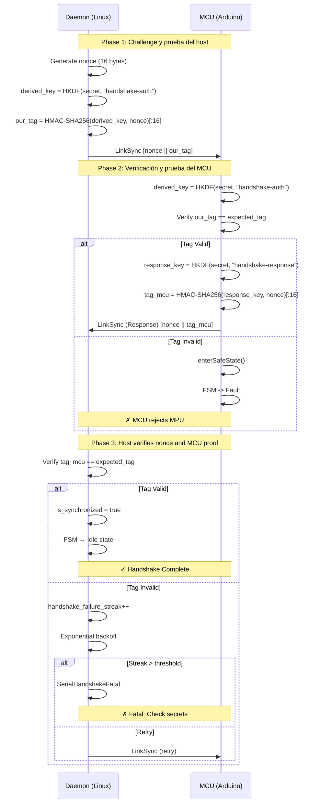

# MCU Bridge v2 — Protocol & Architecture

Este documento unifica y reemplaza documentación histórica y dispersa.

> **Estado de cumplimiento:** Las referencias a SIL-2/IEC 61508 describen objetivos y mecanismos de diseño. Este documento no constituye una evaluación de seguridad funcional ni acredita una certificación.

## Mini-diagrama (flujos y direccionalidad)

```
                 ┌─────────────────────────────────────────────────────────────┐
                 │       Protobuf Cloud Gateway (Dedicated Central Server)     │
                 │  - Hub-and-Spoke (N:1) multiplexing                         │
                 │  - Central Prometheus /metrics (port 9100, FleetMetrics)    │
                 │  - TSDB Sink (InfluxDB / VictoriaMetrics Line Protocol)     │
                 │  - Northbound LocalBridge RPC (GatewayLocalBridgeService)   │
                 │  - Strictly explicit device routing via x-device-id         │
                 │  - Northbound Command Orchestration (send_command)          │
                 │  - mTLS mutual authentication (extract_peer_identity)       │
                 └─────────────────────────────────────────────────────────────┘
                               ▲            ▲                    │
              Device Telemetry │            │ Client gRPC        │ Correlated Commands
              (CloudEnvelope)  │            │ (LocalBridge RPC,  │ (CommandRequest:
              Pure Push        │            │  SubscribeConsole, │  rpc/*, pin, etc.)
                               │            │  x-device-id)      ▼
                               │            │       ┌──────────────────────────────────────┐
                               │            │       │ Client Apps / CLI / Automations      │
                               │            └───────│ (mcubridge-client-examples)          │
                               │                    └──────────────────────────────────────┘
                               │ bidirectional gRPC stream
                               │ (HTTP/2)
                               ▼
                      ┌────────────────────────────────────────────────────────┐
                      │             McuBridge daemon (Linux / MPU)             │
                      │  - Pure Telemetry Push (Zero local HTTP attack surface)│
                      │  - Policy (allow/deny) & Declarative Dispatcher        │
                      │  - RuntimeState snapshots & Local IPC (OpenWrt UBUS)   │
                      │  - Delegated RPC execution (local_bridge_service)      │
                      └────────────────────────────────────────────────────────┘
                               ▲
                               │ Serial HDLC + pw_rpc frames (pw_hdlc + CRC32 FCS, Channel Multiplexing)
                               │ (Ch 1: HDLC_ADDRESS_RPC, Ch 2: HDLC_ADDRESS_LOG, Ch 3: HDLC_ADDRESS_CONSOLE)
                               ▼
                      ┌────────────────────────────────────────────────────────┐
                      │                 MCU firmware (Arduino)                 │
                      │  - Pigweed (pw_hdlc, pw_rpc, pw_log, pw_chrono)        │
                      │  - SIL-2 Zero-Heap, static Nanopb (pb_decode_noinit)   │
                      │  - Server-Stream Telemetry Push (Bridge.sendPinEvent)  │
                      │  - Handshake HMAC-auth & Deterministic etl::fsm        │
                      └────────────────────────────────────────────────────────┘

Notas:
- Central Server Gateway: opera como punto único de observabilidad, ingesta de telemetría y plano de control RPC northbound para toda la flota de dispositivos de borde. Aloja `GatewayLocalBridgeService` (los 25 métodos unarios tipados de `LocalBridge` + el endpoint de streaming `SubscribeConsole`, 26 operaciones en total), enrutando llamadas a cada edge daemon mediante metadatos obligatorios `x-device-id`.
- Edge Node (McuBridge): nodo liviano en modo "Pure Telemetry Push"; no expone puertos HTTP locales ni sockets abiertos sin autenticación. Mantiene un stream gRPC bidireccional saliente hacia el Gateway y ejecuta RPCs delegados (`CommandRequest(command_path="rpc.pb.LocalBridge/<method>")`).
- Local IPC en OpenWrt: comunicación local en el MPU a través de OpenWrt UBUS nativo (`ubus call mcubridge ...`) consumido por scripts del sistema, interfaces CGI y LuCI Web UI.
- Serial HDLC + `pw_rpc`: multiplexa sobre un único enlace físico 3 canales lógicos HDLC (`HDLC_ADDRESS_RPC = 1` para `pw_rpc`, `HDLC_ADDRESS_LOG = 2` para logs tokenizados `pw_tokenizer` y `HDLC_ADDRESS_CONSOLE = 3` para el stream transparente de consola), incluyendo server-streaming en tiempo real (`GpioService/SubscribePins` vía `Bridge.sendPinEvent`). La transferencia de archivos del MCU se realiza mediante upstream `pw_transfer`; el antiguo `FileSystemService/Read` Nanopb fue eliminado.
- gRPC: comunicación bidireccional asíncrona (streaming) entre los daemons de borde y el Gateway central (`mcubridge-gateway`) para telemetría, métricas y despacho de comandos remotos, así como entre clientes externos y el Gateway.
```

## Fuente de verdad

La **fuente de verdad machine-readable** del protocolo vive modularizada en `tools/protocol/` (`config_schema.proto`, `mcu_wire.proto`, `cloud_gateway.proto` para servicios `pw_rpc` y gRPC, mensajes, constantes de aplicación, namespaces, contrato binario, opciones de RPC e IDs de comando). El sistema exige el cumplimiento estricto de la **versión 0x02**.

### Serialización de Payloads y Sobres RPC (`pw_rpc` + Protobuf)
Todos los servicios y payloads del protocolo se definen en los schemas bajo `tools/protocol/` y se transportan dentro de sobres **`pw.rpc.internal.RpcPacket`** sobre tramas **`pw_hdlc`**.

- **Python (daemon y clientes):** utiliza las clases tipadas nativas generadas por `google.protobuf` (`mcu_wire_pb2.py`, `config_schema_pb2.py`, `cloud_gateway_pb2.py`) y los módulos oficiales de Google Pigweed (`pw_hdlc`, `pw_rpc.packets`, `pw_rpc.descriptors.Services`, `pw_tokenizer.Detokenizer`), orquestados por `PW_SERVICES` y las tablas modulares de `protocol.py`.
- **C++ (MCU):** usa Nanopb (`mcu_wire.pb.h` / `config_schema.pb.h`) junto con los stubs generados por `tools/protocol/protoc_gen_mcu_rpc.py` (`mcu_wire.rpc.pb.h`, `pw_rpc.codegen_nanopb`) para codificar/decodificar payloads sin heap dinámico en runtime (`pb_encode` / `pb_decode_noinit`), manteniendo las restricciones estáticas de tamaño definidas en `mcu_wire.options` y `config_schema.options`.

### Despacho de Servicios `pw_rpc` (MCU y MPU)
- **MCU (`pw::rpc::Server` + `pw::rpc::Client` + `pw::rpc::Channel`):** El firmware registra 6 servicios servidor generados por `protoc_gen_mcu_rpc.py` derivados de `rpc::pb::pw_rpc::nanopb::<Service>::Service<Impl>` (`GpioRpcService`, `SystemRpcService`, `ClockSyncRpcService`, `SpiRpcService`, `FileSystemRpcService`, `MailboxRpcService`) sobre `pw::rpc::Channel` (`BridgeClass::RpcChannelOutput`). `ProcessService` y `DataStoreService` exponen clientes generados `rpc::pb::pw_rpc::nanopb::<Service>::Client` para solicitudes iniciadas por el MCU hacia Linux. Todos los servicios y métodos se identifican en tiempo de compilación mediante hashes FNV-1a de 32 bits (`pw::tokenizer::Hash("rpc.pb.<Service>")` y `pw::tokenizer::Hash("<Method>")`).
- **Contrato de tópicos público**: prefijo por defecto, sufijos y tokens canónicos que impactan interoperabilidad (`CLOUD_DEFAULT_TOPIC_PREFIX`, `CLOUD_SUFFIX_*`, `STATUS_REASON_*`).
- **Catálogo Centralizado de Servicios y Operaciones (`PW_SERVICES` + `OPERATIONS` SSOT)**: En Python, `protocol.py` expone `PW_SERVICES` (`pw_rpc.descriptors.Services`) y tablas modulares inmutables (`OPERATIONS`, `RPC_SPECS`, `BY_COMMAND_ID`, `BY_RPC`, `BY_NAME`), resolviendo `service_id`, `method_id`, `request_type`, `response_type`, `cardinality` y `default_factory` directamente desde los descriptores de Pigweed/Protobuf en $O(1)$.

### Determinismo C++17 y Zero-Cost Abstractions
La librería C++ utiliza intensivamente `constexpr` e `if constexpr` (sin STL, `-DETL_NO_STL`) para:
- Evaluación en `constexpr` de identificadores de servicio y método `pw::tokenizer::Hash(...)`.
- Resolución de capacidades de hardware en tiempo de compilación.
- Eliminación de ramas de código inalcanzables según la arquitectura.
- Reducción del uso de RAM al mantener constantes en memoria de programa.

Qué se centraliza en los esquemas Protobuf modulares (y se genera a Python/C++ vía el generador):

- **Servicios y Layouts de payload**: cada método RPC define su servicio en `mcu_wire.proto` (`rpc.pb.*`) o `cloud_gateway.proto` (`rpc.pb.LocalBridge`, `mcubridge.cloud.CloudBridge`) y su mensaje protobuf (`ConsoleWrite`, `ProcessPoll`, `AckPacket`, etc.) con tamaños máximos estáticos en `mcu_wire.options` / `config_schema.options`.
- **Defaults compartidos y metadatos de configuración**: los defaults de `RuntimeConfig`, las constantes referenciadas y los defaults de tópicos se declaran en el schema. Los bindings/clientes consumen los valores generados; UCI puede sobrescribir las opciones de despliegue.
- **Reservas de compatibilidad**: los nombres y números retirados permanecen reservados en el schema. Buf comprueba compatibilidad de wire (`WIRE`); el API fuente de los bindings generados sí puede cambiar.

Este documento **no duplica listados enumerados** para evitar drift; esos catálogos se consideran canónicos en los schemas y en los bindings generados.

Qué **sigue** siendo una decisión de despliegue/runtime y no forma parte del contrato compartido:

- **Valores propios del despliegue**: rutas `/tmp`, directorios de spool, parámetros del exporter/metrics, límites de colas locales y timeouts operativos del daemon. Se configuran en UCI y en la configuración de runtime; no son defaults compartidos del protocolo.

Al ejecutar:

```bash
python3 tools/protocol/generate.py \
  --spec tools/protocol/cloud_gateway.proto \
  --py mcubridge/mcubridge/protocol/protocol.py \
  --cpp mcubridge-library-arduino/src/protocol/rpc_protocol.h \
  --py-client mcubridge-client-examples/mcubridge_client/protocol.py
```

…se regeneran los bindings de enums/constantes y el catálogo `PW_SERVICES` / `OPERATIONS`. Además, el generador produce artefactos protobuf para ambos lados:

- **Python:** módulos de mensajes `mcu_wire_pb2.py`, `config_schema_pb2.py`, `cloud_gateway_pb2.py`, stubs `.pyi`, servicios `mcubridge_grpc.py` y el módulo `protocol.py`.
- **C++ (nanopb/protobuf):** cabeceras de protocolo `rpc_protocol.h` y `rpc_hw_config.h`, junto con las cabeceras Nanopb `mcu_wire.pb.h`/`.c` y `config_schema.pb.h`/`.c` (estáticas, Zero-Heap, sin asignación dinámica de memoria en runtime). La deserialización utiliza `pb_decode_noinit` (Nanopb 0.4.9.2) para eliminar limpiezas `memset` redundantes en estructuras pre-inicializadas de memoria estática.

Todos los artefactos generados deben commitearse en el mismo cambio.

Este documento actúa además como **contrato normativo** de direccionalidad y semántica (ACK/RESP). Si el comportamiento real difiere, se considera un bug: hay que ajustar implementación  + este documento.

---

# Arquitectura

Esta sección resume cómo se articula el daemon, qué garantías de seguridad ofrece y cómo se observan los flujos críticos.

## Capas de Transporte del Enlace MCU ↔ MPU

El protocolo binario MCU Bridge 2 está diseñado para ser completamente agnóstico al medio físico subyacente. Admite:

1. **UART Serie POSIX (Físico / PTY)**:
   - Dispositivos TTY como `/dev/ttyATH0`, `/dev/ttyUSB0`, `/dev/ttyMCU`.
   - Control directo de baudrate y modem pins (`DTR`/`RTS`) vía `python3-pyserial`.
2. **Sockets de Red Inalámbrica (WiFi TCP / Ethernet)**:
   - URIs de conexión configurables: `tcp://192.168.1.150:9000`, `wifi://mcu.local:8888`, `127.0.0.1:9000`.
   - Gestión de streams de red mediante soporte nativo de sockets URL en `pyserial`.
   - En el lado MCU, se utiliza `WiFiClient` (`BridgeWiFi.ino`) manteniendo idéntico framing HDLC y CRC32. El enlace no cifra los frames RPC.
3. **Bluetooth SPP / BLE UART**:
   - Puertos virtuales RFCOMM (`/dev/rfcomm0`) o transceptores transparentes UART sobre BLE Nordic UART Service (NUS).
   - En el lado MCU, se utiliza `BluetoothSerial` o `Serial1` (`BridgeBluetooth.ino`).

## Componentes

- **BridgeService (Python 3.13.9+)**: orquesta de forma unificada la comunicación MCU↔Linux, la ejecución de subprocesos asíncronos y comandos de shell/consola, el sandbox de archivos, el datastore y los servicios especializados (`GpioService`, `ClockSyncService`, `SerialHandshakeManager`).
- **RuntimeState**: mantiene el estado mutable (colas de red, handshake, spool, métricas) y expone snapshots consistentes para status local (JSON/UBUS) y telemetría gRPC Cloud.
- **High-Performance Unified Transport**: El daemon utiliza `SerialTransport` con soporte transparente para `pyserial` (UART POSIX y sockets TCP/WiFi).
- **gRPC Bidirectional Stream (HTTP/2 + TLS 1.3)**: gestiona la comunicación asíncrona tipada y de baja latencia con el Cloud Gateway delegando la negociación y reanudación de sesión TLS 1.3 a OpenSSL y el stack estándar de Python.
- **MCU Firmware (mcubridge-library-arduino)**: implementa el protocolo binario con objetivos de almacenamiento estático y uso de Nanopb 0.4.9.2 (`pb_decode_noinit`); no se afirma certificación SIL-2.
- **Instrumentación**: el daemon escribe `/tmp/mcubridge_status.json` (snapshot en tmpfs para LuCI/UBUS; se pierde al reboot) y transmite periódicamente telemetría consolidada en `br/system/metrics` hacia el Cloud Gateway mediante streaming gRPC.

## Seguridad

1. **TLS recomendado**: `cloud_tls=1` por defecto y se exige `cloud_cafile` para levantar TLS. TLS puede desactivarse para depuración, pero el daemon lo registra como advertencia.
2. **Derivación de Claves (HKDF)**: Se utiliza **HKDF-SHA256 (RFC 5869)** para derivar la clave de autenticación del handshake a partir del `serial_shared_secret`. Esto evita el uso directo del secreto en el bus y proporciona aislamiento criptográfico.
3. **Secreto serie fuerte**: con `serial_shared_secret` no vacío, handshake MCU↔Linux con nonce de 16 bytes y `HMAC-SHA256(derived_key, nonce)` truncado a 16 bytes. El daemon rechaza el placeholder `changeme123`. Un secreto vacío selecciona explícitamente el modo de compatibilidad sin autenticación ni cifrado del enlace; debe limitarse a pruebas aisladas y nunca utilizarse sobre un enlace no confiable.
4. **Auto-Validación (KAT)**: Tanto el MCU como el daemon realizan **Known Answer Tests (KAT)** para SHA256 y HMAC-SHA256 en cada arranque. Si la validación falla, el sistema entra en modo **Fail-Secure** y aborta la operación.
5. **Lista blanca de comandos**: `allowed_commands` se normaliza en `AllowedCommandPolicy` y se aplica al ejecutar procesos/shell.
6. **Namespaces sensibles**: `TopicAuthorization` gobierna toggles `cloud_allow_*` (consola, archivos, datastore, mailbox, shell, GPIO, etc.).
7. **Sandbox de archivos**: `BridgeService` normaliza rutas, bloquea `..`, obliga a permanecer bajo `file_system_root`, aplica `file_write_max_bytes` y `file_storage_quota_bytes`.

## Observabilidad

- **Logging estructurado**: logs JSON (`ts`, `level`, `logger`, `message`, `extra`) enviados a syslog.
- **Destino de logs**: Por defecto OpenWrt usa `logread` (ring buffer en RAM), NO escribe a `/var/log/` en flash.
- **Métricas locales**: snapshots periódicos escritos en `/tmp/mcubridge_status.json` para LuCI y UBUS.
- **Pure Telemetry Push**: el daemon de borde opera sin servidor HTTP local (eliminando puertos de escucha y superficie de ataque en el MPU). Toda la telemetría y métricas se envían vía streaming gRPC al `mcubridge-gateway`.
- **Fleet-Wide Prometheus & TSDB**: el servidor central `mcubridge-gateway` consolida las métricas de todos los dispositivos en `/metrics` (puerto 9100) y las ingiere hacia bases de datos industriales (InfluxDB/VictoriaMetrics).
- **Status Writer**: `/tmp/mcubridge_status.json` como snapshot local (JSON para compatibilidad LuCI).

## Máquinas de Estados (FSM)

El ecosistema implementa máquinas de estados explícitas en C++ (`etl::fsm`) y Python (`python-statemachine`). Sus propiedades, transiciones no manejadas y recuperación deben verificarse con pruebas; su uso no garantiza ausencia de deadlocks ni certificación SIL-2.

### 1. Link Handshake FSM (`HandshakeMachine` — Python Daemon)

Gestiona la autenticación mutua y el ciclo de vida del enlace criptográfico serie entre el daemon y el MCU. Implementada con `python-statemachine`, utiliza el patrón de listener nativo (`SerialHandshakeManager(listeners=[self])`) para ejecutar hooks tipados automáticos (`on_enter_synchronized`, `on_exit_synchronized`, `after_transition`), erradicando código de pegamento y dispatch manual.

#### Estados
| Estado | Descripción |
|--------|-------------|
| `unsynchronized` | Estado inicial. Sin enlace establecido. Tráfico RPC bloqueado. |
| `resetting` | Enviando `rpc.pb.SystemService/LinkReset` para inicializar parámetros de sesión. |
| `syncing` | Enviando `rpc.pb.SystemService/LinkSync` con nonce y tag de desafío. |
| `synchronized` | Enlace establecido y autenticado. Tráfico RPC habilitado. |
| `fault` | Error crítico o de autenticación detectado. |

#### Transiciones
- `start_sync`: `unsynchronized` / `fault` / `resetting` → `resetting` (Inicia secuencia de sincronización)
- `reset_sent`: `resetting` → `syncing` (`LinkReset` enviado)
- `sync_sent`: `syncing` → `syncing` (`LinkSync` enviado; esperando respuesta autenticada)
- `sync_confirmed`: `syncing` → `synchronized` (Respuesta HMAC validada y claves de sesión derivadas)
- `failure`: `resetting` / `syncing` / `synchronized` / `fault` → `fault` (Error de integridad o autenticación)
- `reset`: `*` → `unsynchronized` (Reinicio manual o desconexión)

---

### 2. Physical Link Connection FSM (`LinkConnectionMachine` — Python Daemon)

Gobierna el estado de la conexión física en [RuntimeState](file:///home/ignaciosantolin/arduino-yun-bridge2/mcubridge/mcubridge/state/context.py#L112) de forma desacoplada pero sincronizada con el transporte serie y de red. Sus transiciones son formalmente idempotentes para tolerar reconexiones y re-sincronizaciones sin inconsistencias de estado.

#### Estados
| Estado | Descripción |
|--------|-------------|
| `disconnected` | Enlace físico o socket desconectado. Eventos de sincronización limpios. |
| `connected` | Enlace físico o socket TCP/TTY abierto. Handshake pendiente. |
| `synchronized` | Handshake completado exitosamente. Enlace listo para operaciones RPC. |

#### Transiciones e Idempotencia
- `connect`: `disconnected | synchronized | connected` → `connected`
- `synchronize`: `disconnected | connected | synchronized` → `synchronized`
- `disconnect`: `connected | synchronized | disconnected` → `disconnected`

#### Hooks Nativos
- `on_enter_connected()`: Notifica apertura de canal y registra evento de telemetría.
- `on_enter_synchronized()`: Establece `link_sync_event` y habilita `serial_tx_allowed`.
- `on_enter_disconnected()`: Limpia `link_sync_event` y bloquea `serial_tx_allowed`.

---

### 3. Managed Subprocess Lifecycle FSM (`ProcessMachine` — Python Daemon)

Rastrea formalmente el ciclo de vida de cada subproceso asíncrono ejecutado en Linux bajo `ProcessContext`, garantizando la recolección determinista de recursos y previniendo procesos huérfanos (`zombies`) mediante `psutil`.

#### Estados
| Estado | Descripción |
|--------|-------------|
| `spawning` | Estado inicial. Subproceso en creación (fork/exec). |
| `running` | Subproceso en ejecución activa y monitorizado. |
| `terminating` | Señal de parada enviada (SIGTERM); ventana de gracia activa. |
| `exited` | Estado final (`final=True`). Proceso finalizado y recursos liberados. |

#### Transiciones
- `start`: `spawning` → `running` (PID y handle de proceso obtenidos)
- `terminate`: `running | terminating` → `terminating` (Escalada de apagado graceful)
- `finish`: `spawning | running | terminating` → `exited` (Terminación normal o forzada)
- **Tolerancia a Concurrencia**: Configurada con `allow_event_without_transition = True` para evitar excepciones si múltiples hilos/corutinas finalizan el proceso concurrentemente.

---

### 4. Cloud Gateway Session FSM (`GatewaySessionMachine` — Cloud Gateway)

Rastrea el ciclo de vida de cada sesión gRPC bidireccional en el servidor `ProtobufGateway`, garantizando aislamiento de dispositivos y auditoría estricta de mTLS.

#### Estados
| Estado | Descripción |
|--------|-------------|
| `connected` | Stream gRPC TCP/HTTP3 aceptado. Certificado pendiente de validación. |
| `authenticated` | Identidad mTLS (`commonName`) validada exitosamente. |
| `active` | Primer frame/envelope válido recibido; sesión bidireccional en curso. |
| `closed` | Estado final (`final=True`). Conexión cerrada y removida de `gateway.sessions`. |

#### Transiciones
- `authenticate`: `connected` → `authenticated`
- `activate`: `authenticated | connected` → `active`
- `close`: `*` → `closed` (Cierre controlado o error de red)

---

### 5. Motor Declarativo de Resiliencia y Reintentos (`tenacity`)

El protocolo erradica bucles de reintento manuales mediante el uso exclusivo de `tenacity.AsyncRetrying` y `tenacity.Retrying`:
- **Handshake serie**: `wait_exponential_jitter()` con umbral fatal de reintentos (`_fatal_threshold`) y transición inmediata a `SerialHandshakeFatal`.
- **Transporte serie**: `wait_exponential(multiplier=1, min=1, max=10)` ante errores de E/S transitorios.
- **Reconexión Cloud Gateway**: `wait_exponential(multiplier=reconnect_delay, max=60) + wait_random(0, 2)` para mitigar el efecto *thundering herd*.
- **Supervisión de Tareas (`_run_supervised_task`)**: Reintentos automáticos con backoff exponencial y jitter determinista ante fallos no cancelados.

---

### 6. Asynchronous File I/O & Storage Subsystem (`pathlib.Path` + `asyncio.to_thread`)

Las rutas locales se resuelven y validan con `pathlib.Path`; las operaciones de disco potencialmente bloqueantes se delegan fuera del event loop:
- **Lectura/escritura local en el MPU**: `FileRead` / `FileWrite` operan sobre `file_system_root`, con validación de rutas y cuota. `FileRead` no es un método de `FileSystemService` del MCU ni permite rutas `mcu/`.
- **Transferencia de archivos del MCU**: debe usar upstream `pw_transfer` con handlers y streams acotados; no existe fallback al antiguo RPC Nanopb.
- **Operaciones de disco**: `asyncio.to_thread` ejecuta filesystem y `psutil.disk_usage` sin bloquear `asyncio`/`uvloop`.
- **Validación de rutas**: se comprueba que la ruta resuelta permanezca dentro de `file_system_root`; errores de acceso y filesystem se registran explícitamente.

---

### 7. ETL FSM (MCU Firmware) — Diseño de estados

Máquina de estados estática en el MCU (C++) para la gestión del enlace RPC.
Implementada con `etl::fsm` y `enum class StateId : uint8_t` para cero conversiones narrowing.

#### Estados
| Estado | ID | Descripción |
|--------|----|-------------|
| `STARTUP` | 0 | Estado inicial al arrancar. Esperando primer reset. |
| `UNSYNCHRONIZED` | 1 | Enlace no establecido. Esperando handshake. |
| `HANDSHAKE` | 2 | Handshake en progreso (`LinkSync` enviado). |
| `SYNCHRONIZED` | 3 | Enlace sincronizado y autenticado, listo para operar. |
| `AWAITING_ACK` | 4 | Frame crítico enviado, esperando confirmación ACK. |
| `FAULT` | 5 | Fallo crítico (timeout, auth fail). Llama `hal::forceSafeState()`. |

#### Diagrama de Transiciones (MCU)

```
                    ┌─────────────────────┐
                    │       STARTUP       │◄────────────────────┐
                    │        (0)          │◄─ EvHandshakeFailed ┤
                    └──────────┬──────────┘                     │
                               │ EvReset                        │
                               ▼                                │
                    ┌─────────────────────┐                     │
                    │   UNSYNCHRONIZED    │─── EvTimeout ──► FAULT
                    │        (1)          │                     │
                    └──────────┬──────────┘                     │
                               │ EvHandshakeStart               │
                               ▼                                │
                    ┌─────────────────────┐                     │
                    │     HANDSHAKE       │─── EvTimeout ──────►┤
                    │        (2)          │                     │
                    └──────────┬──────────┘                     │
                               │ EvHandshakeComplete            │
                               ▼                                │
               ┌──────────────────────────┐                    │
   EvAckRcvd ◄─┤      SYNCHRONIZED        │─── EvTimeout ─────►┤
               │           (3)            │                    │
               └──────────┬───────────────┘                    │
                          │ EvSendCritical                      │
                          ▼                                     │
               ┌─────────────────────┐                         │
               │    AWAITING_ACK     │─── EvTimeout ──────────►┘
               │        (4)          │
               └─────────────────────┘

[FAULT (5)] ──► EvReset ──► UNSYNCHRONIZED
FaultState::on_enter_state() → hal::forceSafeState() [SIL-2]
```

---

## Estado seguro (Fail-Safe) — comportamiento implementado

Esta sección documenta formalmente el comportamiento del sistema ante condiciones de fallo, cumpliendo con los requisitos de Seguridad Funcional.

### Definición de Estado Seguro

El **Estado Seguro** es la configuración a la que el sistema transiciona automáticamente cuando detecta un fallo irrecuperable. En este estado:

1. **GPIO**: Todos los pines configurados por el Bridge se resetean a `INPUT` (alta impedancia), evitando actuaciones no intencionadas.
2. **Comunicación Serial**: El enlace RPC se considera no sincronizado (`_synchronized = false`).
3. **Colas pendientes**: Se vacían todas las colas TX/RX para evitar procesamiento de datos corruptos.
4. **Flow Control**: Se libera cualquier estado XOFF para evitar deadlocks.

### Matriz de Transición a Estado Seguro

| Condición de Fallo | Acción MCU | Acción Daemon | Estado Resultante |
|--------------------|------------|---------------|-------------------|
| CRC Mismatch | Reset parser, emit `STATUS_CRC_MISMATCH` | Log + reintento | Link degradado |
| Frame Malformed | Reset parser, emit `STATUS_MALFORMED` | Log + descarte | Link operativo |
| Buffer Overflow | Reset parser, descarte silencioso | Log + descarte | Link operativo |
| Handshake Timeout | `enterSafeState()` | Backoff exponencial | Link no sincronizado |
| Handshake Auth Fail | `enterSafeState()` | `SerialHandshakeFatal` si > N fallos | Link rechazado |
| Serial Disconnect | N/A (hardware) | Clear queues, `serial_tx_allowed.set()` | Reconexión pendiente |
| ACK Timeout (max retries) | `_awaiting_ack = false` | Log + siguiente frame | Frame perdido |
| Watchdog Timeout | Reset MCU (AVR `wdt_reset()`) | Depende de procd | Reinicio completo |

### Invariantes de Seguridad

1. **No hay alocación dinámica post-inicialización**: Todos los buffers son estáticos con tamaños conocidos en compile-time.
2. **No hay recursión**: Todas las funciones usan iteración para evitar stack overflow.
3. **Validación de rangos**: Cada entrada externa se valida contra límites antes de uso.
4. **CRC obligatorio**: Ningún frame se procesa sin verificación CRC exitosa.
5. **Timeout en todas las operaciones bloqueantes**: Previene deadlocks indefinidos.

### Recuperación Automática

El sistema implementa recuperación automática con backoff exponencial:

```
Handshake retry: base=1s, max=60s, factor=2x
Serial reconnect: base=reconnect_delay (UCI), max=8x base
Cloud spool retry: base=5s, max=60s
```

### Monitoreo de Estado Seguro

El estado de salud del enlace se expone en:
- `/tmp/mcubridge_status.json` → campo `is_synchronized`
- Métricas gRPC transmitidas al Gateway → Prometheus gauge `mcubridge_device_link_synchronized` en el Gateway central.

## Configuración relevante

| Clave | Descripción | Valor por defecto |
| --- | --- | --- |
| `status_interval` | Intervalo de emisión periódica de telemetría y snapshots. | `1.0` |
| `debug_logging` | Fuerza logs `DEBUG`. | `0` |
| `allowed_commands` | Lista blanca de comandos shell. | `""` |
| `file_write_max_bytes` | Máximo por write (gRPC/IPC y/o `FileSystemService/Write`). | `262144` |
| `file_storage_quota_bytes` | Cuota global dentro de `file_system_root`. | `4194304` |

## Flujo de inicio (resumen)

1. `main()` carga config, inicializa logging, crea `RuntimeState`.
2. Se arranca un `TaskGroup` con lector serie, streaming gRPC hacia `mcubridge-gateway` (con despachador de RPCs delegados), status writer, watchdog opcional y publicador de telemetría/snapshots.
3. Fallas críticas se elevan como `CRITICAL` para reinicios supervisados (`procd`).

---

## Notas de plataforma (Arduino MCU)

### Consola del kernel y conflicto con ttyATH0

El Arduino MCU presenta un conflicto de hardware: el puerto serial `/dev/ttyATH0` es usado simultáneamente por:

1. **Consola del kernel** (legacy 250000 baud, configurada en bootargs)
2. **Protocolo McuBridge** (opera a 115200 baud)

Aunque los baud rates difieren, los mensajes `printk` del kernel pueden corromper frames HDLC del protocolo, causando errores de FCS/decodificación como:

```
HDLC frame error on link: FrameStatus.FCS_MISMATCH
```

**Solución automática**: El paquete `mcubridge` incluye el script UCI-defaults `95-mcubridge-silence-kernel-console` que:

1. Crea `/etc/sysctl.d/99-mcubridge-no-console.conf` con `kernel.printk = 0 0 0 0`
2. Añade un respaldo en `/etc/rc.local`

Esto silencia los mensajes del kernel en la consola serial sin recompilar el kernel ni modificar U-Boot.

**Verificación manual**:
```bash
# Ver estado actual
cat /proc/sys/kernel/printk

# Silenciar temporalmente
echo 0 > /proc/sys/kernel/printk
dmesg -n 1
```

**Nota**: Si se necesita debug del kernel, se puede acceder vía `dmesg` o `logread` sin afectar el protocolo serial.

---

# Protocolo binario (Google Pigweed `pw_hdlc` + `pw_rpc`)

## 1. Visión general

El enlace binario entre el microcontrolador (MCU) y el procesador Linux (MPU) se basa en **Google Pigweed**:
- **Capa de enlace (`pw_hdlc`):** Encapsulado HDLC con delimitadores `0x7E`, byte-stuffing (`0x7D`), control UI (`0x03`), secuencia de verificación de trama **CRC-32 IEEE 802.3 (FCS)** y multiplexación nativa por dirección lógica.
- **Capa de procedimiento remoto (`pw_rpc`):** Transporte de sobres Protobuf `pw.rpc.internal.RpcPacket` (`REQUEST`, `RESPONSE`, `SERVER_STREAM`, `SERVER_ERROR`) direccionados por hashes FNV-1a de 32 bits (`service_id`, `method_id`) y correlacionados por `call_id`.
- **Serialización de payloads (Protobuf / Nanopb):** Las definiciones viven en `tools/protocol/` (`mcu_wire.proto`, `config_schema.proto`, `cloud_gateway.proto`), generando structs estáticos C++ (`mcu_wire.pb.h`, `config_schema.pb.h`) y descriptores/mensajes Python (`mcu_wire_pb2.py`, `config_schema_pb2.py`, `cloud_gateway_pb2.py`, `protocol.py`).

## 1.1 Contrato de direccionalidad, `RpcPacket` y confirmación

### Tipos de llamadas y paquetes `pw_rpc`

- **Unary Request / Response (`PacketType.REQUEST` → `PacketType.RESPONSE`):** El emisor envía un `RpcPacket` con `type = REQUEST` (`0`), `service_id`, `method_id`, `call_id` y el payload Protobuf serializado; el receptor responde con `type = RESPONSE` (`1`), el mismo `call_id`, `status` y el payload de respuesta.
- **Server-Streaming (`PacketType.SERVER_STREAM`):** El MCU emite eventos asíncronos (p. ej. `PinUpdateEvent` en `rpc.pb.GpioService/SubscribePins`) mediante paquetes `type = SERVER_STREAM` (`4`).
- **Errores de Servidor (`PacketType.SERVER_ERROR`):** Si un servicio o método no existe o el payload está corrupto, el receptor responde con `type = SERVER_ERROR` (`5`) y el código `pw::Status` correspondiente.
- **Comandos ACK-only:** Son métodos unarios cuyo éxito se confirma mediante `RESPONSE` con `status = 0` (`Ok`) o `AckPacket` (`STATUS_ACK`):
  Esta lista está alineada con el spec (bindings Python: `OPERATIONS` con `requires_ack=True`):
  - `rpc.pb.GpioService/SetPinMode`, `rpc.pb.GpioService/DigitalWrite`, `rpc.pb.GpioService/AnalogWrite` (Linux → MCU)
  - `rpc.pb.ConsoleService/ConsoleWrite` (bidireccional)
  - `rpc.pb.DataStoreService/Put` (MCU → Linux)
  - `rpc.pb.MailboxService/Push` (bidireccional)
  - `rpc.pb.FileSystemService/Write` (bidireccional)

## 2. Transporte y Multiplexación de Canales HDLC (`pw_hdlc`)

Las tramas se encapsulan con **Pigweed HDLC (`pw_hdlc`)** delimitadas por el flag `0x7E` (`HDLC_FRAME_DELIMITER`) y protegidas por un FCS **CRC-32 (IEEE 802.3)** de 4 bytes en little-endian antes del delimitador de cierre.

El enlace físico comparte **3 canales lógicos HDLC** independientes:

| Dirección HDLC | Constante | Uso |
| :--- | :--- | :--- |
| `1` | `HDLC_ADDRESS_RPC` | Paquetes `pw_rpc` (`pw.rpc.internal.RpcPacket`): llamadas unarias, respuestas, errores y streams (`SubscribePins`). |
| `2` | `HDLC_ADDRESS_LOG` | Diagnósticos y logs tokenizados del MCU (`pw::log` / `pw_tokenizer`), decodificados en el MPU con `pw_tokenizer.Detokenizer`. |
| `3` | `HDLC_ADDRESS_CONSOLE` | Stream bidireccional transparente de bytes de consola (`Console`). |

## 3. Formato de trama (`pw_hdlc` + `RpcPacket`)

```
+----------+-------------+--------------+-------------------------------+---------------+----------+
| Flag     | Address     | Control      | Information (Payload)         | FCS (CRC32)   | Flag     |
| 0x7E (1) | Varint (1+) | 0x03 UI (1)  | RpcPacket / TokenLog / Bytes  | 4B Little-End | 0x7E (1) |
+----------+-------------+--------------+-------------------------------+---------------+----------+
```

### 3.1 Sobre Protobuf `pw.rpc.internal.RpcPacket` (Canal `HDLC_ADDRESS_RPC = 1`)

| Campo Protobuf | Número | Tipo | Descripción |
| --- | --- | --- | --- |
| `type` | `1` | `PacketType` | `REQUEST (0)`, `RESPONSE (1)`, `CLIENT_ERROR (2)`, `CLIENT_REQUEST_COMPLETION (3)`, `SERVER_STREAM (4)`, `SERVER_ERROR (5)`, `CLIENT_STREAM (6)`. |
| `channel_id` | `2` | `uint32` | Canal RPC (`RPC_DEFAULT_CHANNEL_ID = 1`). |
| `service_id` | `3` | `fixed32` | Hash FNV-1a de 32 bits del nombre completo del servicio (`pw::tokenizer::Hash("rpc.pb.<Service>")`). |
| `method_id` | `4` | `fixed32` | Hash FNV-1a de 32 bits del nombre del método (`pw::tokenizer::Hash("<Method>")`). |
| `payload` | `5` | `bytes` | Mensaje Protobuf del método serializado con Nanopb (MCU) o `google.protobuf` (MPU). |
| `status` | `6` | `uint32` | Código `pw::Status` (`0 = OK`, `13 = INTERNAL`, etc.). |
| `call_id` | `7` | `uint32` | Identificador de correlación de llamada para emparejar peticiones, respuestas y reintentos. |

### 3.2 Integridad y Autenticación
- **Detección de errores (FCS):** Todo frame HDLC incluye un CRC-32 IEEE 802.3 de 4 bytes verificado por `pw::hdlc::DecoderBuffer` en el MCU y `pw_hdlc.decode.FrameDecoder` en el daemon. CRC detecta errores accidentales; no autentica frames.
- **Autenticación de `LinkSync`:** Con secreto compartido configurado, el host envía un HMAC-SHA256 de 16 bytes y el MCU verifica el tag antes de habilitar métodos fuera de `pre_sync_allowed`. El MCU responde con un HMAC bajo un `HKDF info` distinto para que el host compruebe la identidad compartida del MCU. Ambos tags cubren un nonce host de 16 bytes.
- Si el secreto está vacío, el protocolo requiere tags vacíos y el enlace queda **sin autenticación**. No existe fallback desde un tag inválido.
- **Cifrado de enlace:** Tras un `LinkSync` autenticado, los payloads HDLC de RPC (`1`), logs (`2`) y consola (`3`) se cifran y autentican con ChaCha20-Poly1305. El envelope es `contador[8 bytes BE] || ciphertext || tag[16 bytes]`; el nonce es `00 00 00 00 || contador` y el AAD es `dirección HDLC[1 byte] || contador`.
- Las claves host→MCU y MCU→host se derivan como dos bloques de 32 bytes mediante HKDF-SHA256 (`IKM=secreto`, `salt=nonce del handshake`, `info="session-key"`). Cada dirección mantiene un contador común a todos los canales protegidos; el receptor rechaza contadores cero o no crecientes.
- `LinkSync` y su respuesta autenticada ocurren antes de activar AEAD. `LinkReset` también es un control plaintext explícito de recuperación; no habilita tráfico de datos plaintext y puede polarizar una nueva sincronización.
- La protección anti-replay de contadores solo dura lo que la sesión. No se garantiza el rechazo de handshakes o frames previamente capturados tras un reinicio del MCU, porque no hay una fuente de frescura criptográfica del MCU compartida y persistente entre las placas soportadas.
- Los peers deben actualizarse juntos: los tags de respuesta usan un dominio distinto y no hay negociación ni modo de compatibilidad para la semántica anterior.

### 3.3 Implementación de bibliotecas (Wire Format)

| Componente | Función | Implementación MCU (Arduino/C++) | Implementación Daemon (Python) |
| :--- | :--- | :--- | :--- |
| **Autenticación del handshake** | HKDF-SHA256 + HMAC-SHA256 | **Mbed TLS PSA** para HMAC; Mbed TLS 4 para HKDF en AVR/SAMD y **wolfCrypt 5.8.4** en ESP32. | **`cryptography`** para HKDF/HMAC y comparación constante. |
| **Protección del enlace** | ChaCha20-Poly1305 con claves direccionales y contadores monotónicos por sesión | **Mbed TLS 4** en AVR/SAMD y **wolfCrypt 5.8.4** en ESP32. | **`cryptography`** (`ChaCha20Poly1305`); envuelve/desenvuelve los payloads HDLC. |
| **HDLC Framing & Multiplexing** | Framing (`0x7E`) + CRC-32 FCS | **Google Pigweed**: `pw::hdlc::WriteUIFrame` / `pw::hdlc::DecoderBuffer`. | **Google Pigweed**: `pw_hdlc.encode` / `pw_hdlc.decode.FrameDecoder`. |
| **Motor RPC & Despacho** | Enrutamiento de `RpcPacket` | **Google Pigweed**: `pw::rpc::Server`, `pw::rpc::Client`, `pw::rpc::Channel` y `protoc_gen_mcu_rpc.py` (`rpc::pb::pw_rpc::nanopb::<Service>::Service` para 6 servicios servidor registrados y `Client` para `ProcessService` y `DataStoreService`). | **Google Pigweed**: `pw_rpc.packets` + `pw_rpc.descriptors.Services` (`PW_SERVICES`) para los 8 contratos Protobuf. |
| **Logs Tokenizados** | Telemetría diagnóstica cero-RAM | **Google Pigweed**: fachada `pw::log::SetLogSink` (`pw_log` + `pw_tokenizer`). | **Google Pigweed**: `pw_tokenizer.Detokenizer`. |
| **Reloj Monótono MCU** | Timekeeping atómico determinista | **Google Pigweed**: `pw::chrono::SystemClock::now()` (`pw_chrono`). | Reloj monótono `time.monotonic()`. |
| **Payload Serialization** | Codificación de mensajes RPC | **Nanopb 0.4.9.2** (`pb_encode` / `pb_decode_noinit`, Zero-Heap). | **Protobuf** (`google.protobuf` / direct `*_pb2.py` modules, orquestado vía `PW_SERVICES`). |

## 4. Códigos de estado (`Status` / `pw_status`)

El protocolo utiliza los códigos de estado canónicos de Pigweed (`pw::Status`) y gRPC:

| Código | Nombre | Constante C++ | Descripción |
| --- | --- | --- | --- |
| `0` | `OK` | `StatusCode::STATUS_OK` | Operación completada con éxito. |
| `1` | `CANCELLED` | `StatusCode::STATUS_CANCELLED` | La operación fue cancelada. |
| `2` | `UNKNOWN` | `StatusCode::STATUS_UNKNOWN` | Error genérico o desconocido. |
| `3` | `INVALID_ARGUMENT` | `StatusCode::STATUS_INVALID_ARGUMENT` | Argumento o estructura de payload inválido. |
| `4` | `DEADLINE_EXCEEDED` | `StatusCode::STATUS_DEADLINE_EXCEEDED` | Tiempo límite de operación excedido (timeout). |
| `5` | `NOT_FOUND` | `StatusCode::STATUS_NOT_FOUND` | Entidad o recurso no encontrado. |
| `6` | `ALREADY_EXISTS` | `StatusCode::STATUS_ALREADY_EXISTS` | La entidad ya existe. |
| `7` | `PERMISSION_DENIED` | `StatusCode::STATUS_PERMISSION_DENIED` | Acceso no autorizado para el llamador. |
| `8` | `RESOURCE_EXHAUSTED` | `StatusCode::STATUS_RESOURCE_EXHAUSTED` | Recurso agotado o desbordamiento de buffer. |
| `9` | `FAILED_PRECONDITION` | `StatusCode::STATUS_FAILED_PRECONDITION` | El sistema no se encuentra en el estado requerido. |
| `10` | `ABORTED` | `StatusCode::STATUS_ABORTED` | Operación abortada. |
| `11` | `OUT_OF_RANGE` | `StatusCode::STATUS_OUT_OF_RANGE` | Índice o valor fuera de rango. |
| `12` | `UNIMPLEMENTED` | `StatusCode::STATUS_UNIMPLEMENTED` | Operación definida pero no implementada. |
| `13` | `INTERNAL` | `StatusCode::STATUS_INTERNAL` | Fallo interno del sistema. |
| `14` | `UNAVAILABLE` | `StatusCode::STATUS_UNAVAILABLE` | Servicio o transporte no disponible. |
| `15` | `DATA_LOSS` | `StatusCode::STATUS_DATA_LOSS` | Pérdida irrecuperable de datos o fallo CRC. |
| `16` | `UNAUTHENTICATED` | `StatusCode::STATUS_UNAUTHENTICATED` | Fallo de autenticación en handshake o trama. |

## 5. Servicios y Métodos RPC (`rpc.pb.*`)

## 5.0 Correlación por `call_id`, retries e idempotencia

- **Correlación mediante `call_id`:** Cada invocación `pw_rpc` incluye un `call_id` en `RpcPacket` que permite correlacionar respuestas asíncronas y descartar duplicados o respuestas huérfanas.
- **Retries acotados:** `SerialTransport` gestiona los reintentos declarativos mediante `tenacity` si no recibe respuesta dentro de `response_timeout_ms`.

### 5.1 Sistema y control de flujo (`rpc.pb.SystemService`)

- **`rpc.pb.SystemService/GetVersion` (Linux → MCU)**
  - Petición: `SubscribeRequest` (vacío).
  - Respuesta: mensaje Protobuf `VersionResponse` (`major`, `minor`, `patch`).

- **`rpc.pb.SystemService/GetFreeMemory` (Linux → MCU)**
  - Petición: `SubscribeRequest` (vacío).
  - Respuesta: mensaje Protobuf `FreeMemoryResponse` (`value`).

- **`rpc.pb.SystemService/LinkSync` (Linux ↔ MCU)**
  - Petición: mensaje Protobuf `LinkSync` con `nonce` de 16 bytes y `tag` de 16 bytes si hay secreto; `tag` vacío si la autenticación está explícitamente deshabilitada.
  - Respuesta (`PacketType.RESPONSE`, MCU → Linux): mensaje `LinkSync` con el mismo `nonce` y una prueba HMAC bajo un dominio HKDF separado (`"mcubridge-link-sync-resp-v2"`); `tag` vacío en modo no autenticado.

#### Secuencia de autenticación `LinkSync`




#### Handshake Frame Example (`pw_hdlc` + `RpcPacket`)

```
# rpc.pb.SystemService/LinkSync request (Linux → MCU)
# HDLC Address: 1 (HDLC_ADDRESS_RPC), Control: 0x03 (UI)
# RpcPacket: type=REQUEST (0), channel_id=1, service_id=Hash("rpc.pb.SystemService"),
#            method_id=Hash("LinkSync"), call_id=1, payload=HandshakeProof(nonce[16], tag[16])
# FCS: 4-byte CRC32 (IEEE 802.3, Little Endian)

HDLC Wire Frame:
  7E                              # Opening Flag
  03 03                           # Address=1 (varint encoded: (1<<1)|1 = 0x03), Control=0x03 (UI)
  <Serialized RpcPacket bytes>    # Protobuf RpcPacket containing HandshakeProof payload
  XX XX XX XX                     # CRC32 FCS (4 bytes, escaped if 0x7E/0x7D)
  7E                              # Closing Flag
```

- **`rpc.pb.SystemService/LinkReset` (Linux → MCU)**
  - Petición: opcionalmente `LinkReset { ack_timeout_ms, retry_limit, response_timeout_ms }`.
  - Respuesta: `AckPacket`.

- **`rpc.pb.SystemService/SetBaudrate` (Linux → MCU)**
  - Petición: `SetBaudratePacket { baudrate: uint32 }`.
  - Respuesta: `AckPacket`.

- **`rpc.pb.SystemService/GetCapabilities` (Linux → MCU)**
  - Petición: `Empty`.
  - Respuesta: mensaje protobuf `Capabilities { ver, arch, dig, ana, feat }`.
  - **Propósito:** Introspección estática de hardware (SIL-2 Safety). Permite al MPU validar que la configuración de pines no excede los límites físicos del MCU.
  - **Features Bitmask (`feat`, u32):**
    | Bit | Valor | Feature | Descripción |
    | :--- | :--- | :--- | :--- |
    | 0 | `1` | Watchdog | MCU Watchdog habilitado. |
    | 1 | `2` | Debug Frames | Logging de tramas activo. |
    | 2 | `4` | Debug IO | Logging de GPIO activo. |
    | 3 | `8` | EEPROM | Memoria no volátil disponible. |
    | 4 | `16` | DAC | Salida analógica real (True DAC). |
    | 5 | `32` | HW Serial 1 | Segundo puerto serial hardware disponible. |
    | 6 | `64` | FPU | Unidad de punto flotante hardware. |
    | 7 | `128` | 3.3V Logic | Niveles lógicos de 3.3V (vs 5V). |
    | 8 | `256` | Big Buffer | Buffer RX serial extendido (>64 bytes). |
    | 9 | `512` | I2C | Soporte hardware I2C (Wire/SDA/SCL). |
    | 10 | `1024` | SPI | Soporte hardware SPI (SCK/MOSI/MISO). |
    | 11 | `2048` | SD | Tarjeta SD física detectada y funcional. |
    | 12 | `4096` | Filesystem | Sistema de archivos habilitado. |
    | 13 | `8192` | Process | Gestión de procesos habilitada. |

- **`rpc.pb.SystemService/Xoff` (MCU → Linux)** / **`rpc.pb.SystemService/Xon` (MCU → Linux)**
  - Sin payload (`Empty`).
  - Semántica: `Xoff` indica backpressure del MCU (buffers/colas cerca de saturación). Linux debe **detener todo envío** de frames al MCU hasta recibir `Xon`.
  - Implementación esperada en daemon: el gating de TX es global (no sólo consola), y debe liberarse también ante desconexión para evitar deadlocks.

### 5.1.1 Control de Flujo XON/XOFF (Detalle)

El protocolo implementa control de flujo por software para proteger los buffers limitados del MCU (típicamente 64-256 bytes de RX en AVR).

#### Mecanismo

```
MCU detecta RX buffer > 75% → envía rpc.pb.SystemService/Xoff → Linux pausa TX
MCU detecta RX buffer < 25% → envía rpc.pb.SystemService/Xon  → Linux reanuda TX
```

#### Parámetros de Configuración (MCU)

| Macro | Valor por defecto | Descripción |
| --- | --- | --- |
| `BRIDGE_HW_RX_BUFFER_SIZE` | 64 | Tamaño asumido del buffer RX hardware |
| `BRIDGE_RX_HIGH_WATER_MARK` | 75% (48 bytes) | Umbral para emitir XOFF |
| `BRIDGE_RX_LOW_WATER_MARK` | 25% (16 bytes) | Umbral para emitir XON |

#### Comportamiento del Daemon (Linux)

1. **Recepción de XOFF**: El daemon detiene inmediatamente todo envío de frames hacia el MCU.
2. **Recepción de XON**: El daemon reanuda el envío normal de frames.
3. **Desconexión**: Al detectar desconexión del puerto serial, el estado de pausa se limpia automáticamente para evitar deadlocks.
4. **Timeout**: Si el daemon permanece en estado XOFF por más de `response_timeout_ms`, puede considerar el enlace como degradado.

#### Notas de Implementación

- `Xoff` y `Xon` **no requieren ACK** (`requires_ack = false` en `mcu_wire.proto`).
- Son métodos unidireccionales MCU → Linux únicamente.
- El daemon debe aplicar el gating de forma **global** (todos los comandos, no solo consola).
- La pausa debe liberarse inmediatamente ante pérdida de conexión serial.

### 5.2 GPIO (`rpc.pb.GpioService`)

- **`rpc.pb.GpioService/SetPinMode` (`SetPinMode`, Linux → MCU)**: `PinMode { pin, mode }`. Retorna `AckPacket`.
- **`rpc.pb.GpioService/DigitalWrite` (`DigitalWrite`, Linux → MCU)**: `DigitalWrite { pin, value }`. Retorna `AckPacket`.
- **`rpc.pb.GpioService/AnalogWrite` (`AnalogWrite`, Linux → MCU)**: `AnalogWrite { pin, value }`. Retorna `AckPacket`.
- **`rpc.pb.GpioService/DigitalRead` (`DigitalRead`, Linux → MCU)**: `PinRead { pin }`. Respuesta: `DigitalReadResponse { value }`.
- **`rpc.pb.GpioService/AnalogRead` (`AnalogRead`, Linux → MCU)**: `PinRead { pin }`. Respuesta: `AnalogReadResponse { value }`.
- **`rpc.pb.GpioService/SubscribePins` (Server-Streaming, Linux ↔ MCU)**: Payload `PinSubscribeRequest { pin, mode, interval_ms, hysteresis, enabled }`. Evento de streaming (`PacketType.SERVER_STREAM`) emitido por el MCU cuando el valor medido cambia según el intervalo e histéresis configurados o mediante llamada directa a `Bridge.sendPinEvent(pin, val)`. El daemon lo reenvía a la nube bajo el tópico canónico `{prefix}/evt/GpioService/PinUpdateEvent/{pin}`.

#### Control Bidireccional de GPIO desde Cloud Gateway

El Gateway central puede orquestar actuadores y pines en dispositivos de borde mediante invocaciones tipadas de `LocalBridge` o despacho de comandos en tópicos canónicos:
- **Comandos Canónicos Cloud**:
  - Escritura digital: `{prefix}/req/GpioService/DigitalWrite` (o `devices/{device_id}/req/GpioService/DigitalWrite`) con payload Protobuf `DigitalWrite { pin, value }`.
  - Modo de pin: `{prefix}/req/GpioService/SetPinMode` con payload Protobuf `PinMode { pin, mode }`.
  - Lectura digital: `{prefix}/req/GpioService/DigitalRead` con payload Protobuf `PinRead { pin }`.
  - Escritura analógica: `{prefix}/req/GpioService/AnalogWrite` con payload Protobuf `AnalogWrite { pin, value }`.
  - Lectura analógica: `{prefix}/req/GpioService/AnalogRead` con payload Protobuf `PinRead { pin }`.
  - Suscripción de pin: `{prefix}/req/GpioService/SubscribePins` con payload Protobuf `PinSubscribeRequest { pin, mode, interval_ms, hysteresis, enabled }`.
- **Ejecución en Daemon**: El daemon valida la autorización del namespace (`cloud_allow_digital_write`, `cloud_allow_pin_read`, etc.), despacha el comando al MCU (p.ej. `rpc.pb.GpioService/DigitalWrite`), y emite de vuelta el mensaje Protobuf tipado de respuesta (`GenericResponse`, `DigitalReadResponse`, `AnalogReadResponse`, etc.).
- **Correlación Asíncrona**: Cada request/response se correlaciona con `call_id` / `sequence_id` garantizando entrega determinista fin a fin.
- **Eventos de Telemetría**: Las actualizaciones emitidas por el microcontrolador (`PinUpdateEvent`) se transmiten hacia el Gateway en el tópico `{prefix}/evt/GpioService/PinUpdateEvent/{pin}`.

#### GPIO Frame Examples (`pw_hdlc` + `RpcPacket`)

```
# rpc.pb.GpioService/DigitalWrite: Set pin 13 HIGH
# HDLC Address: 1 (HDLC_ADDRESS_RPC), Control: 0x03 (UI)
# RpcPacket: type=REQUEST (0), channel_id=1, service_id=Hash("rpc.pb.GpioService"),
#            method_id=Hash("DigitalWrite"), call_id=10, payload=DigitalWrite(pin=13, value=1)

# rpc.pb.GpioService/AnalogRead: Read analog pin A0 (pin=14)
# RpcPacket: type=REQUEST (0), channel_id=1, service_id=Hash("rpc.pb.GpioService"),
#            method_id=Hash("AnalogRead"), call_id=11, payload=PinRead(pin=14)

# AnalogRead response: Value = 512
# RpcPacket: type=RESPONSE (1), channel_id=1, service_id=Hash("rpc.pb.GpioService"),
#            method_id=Hash("AnalogRead"), call_id=11, payload=AnalogReadResponse(value=512)
```


### 5.3 Consola (Canal HDLC `HDLC_ADDRESS_CONSOLE = 3` y RPC)

- **Stream HDLC Nativo (`HDLC_ADDRESS_CONSOLE = 3`, bidireccional):**
  - Los bytes de consola se transmiten directamente en tramas UI de `pw_hdlc` sobre la dirección `3` (`encode_hdlc_console`), aislando el flujo de consola del canal de control `pw_rpc` (`HDLC_ADDRESS_RPC = 1`).
- **`rpc.pb.ConsoleService/ConsoleWrite` (Linux ↔ MCU):**
  - Payload: mensaje protobuf `ConsoleData { data: bytes }` limitado por `MAX_PAYLOAD_SIZE`. Retorna `AckPacket`.

### 5.4 Datastore (`rpc.pb.DataStoreService`)

- **`rpc.pb.DataStoreService/Put` (MCU → Linux)**: Payload `DatastorePut { key, value }`. Retorna `AckPacket`.
- **`rpc.pb.DataStoreService/Get` (MCU → Linux)**: Payload `DatastoreGet { key }`. Retorna `DatastoreGetResp { value }`.

Notas operativas:

- El datastore del daemon es **volátil (RAM)**: se mantiene en memoria mientras el proceso está vivo y **no persiste a disco**.
- La persistencia “durable” del sistema se limita al spool de Nube (si está habilitado) y por defecto se ubica en `/tmp` para minimizar desgaste de flash.

### 5.5 Mailbox (`rpc.pb.MailboxService`)

- **`rpc.pb.MailboxService/Read` (MCU → Linux)**: Payload `SubscribeRequest` (vacío). Respuesta: `MailboxReadResponse { content, message_id }`.
- **`rpc.pb.MailboxService/Processed` (MCU → Linux)**: Payload `MailboxProcessed { message_id }`. Retorna `AckPacket`.
- **`rpc.pb.MailboxService/Available` (MCU → Linux)**: Payload `SubscribeRequest` (vacío). Respuesta: `MailboxAvailableResponse { count }`.
- **`rpc.pb.MailboxService/Push` (Linux ↔ MCU, bidireccional)**: Payload `MailboxPush { data }`. Retorna `AckPacket`.

### 5.6 Sistema de archivos (`rpc.pb.FileSystemService`)

- **`rpc.pb.FileSystemService/Write` (Linux ↔ MCU, bidireccional)**: Payload `FileWrite { path, data }`. Retorna `AckPacket`.
- **Lectura de archivos del MCU**: upstream `pw_transfer` (`pw.transfer.Transfer.Read`); no forma parte de `FileSystemService`.
- **`rpc.pb.FileSystemService/Remove` (Linux ↔ MCU)**: Payload `FileRemove { path }`. Retorna `AckPacket`.

### 5.7 Gestión de procesos (`rpc.pb.ProcessService`)

- **`rpc.pb.ProcessService/RunAsync` (MCU → Linux)**: Payload `ProcessRunAsync { command }`. Respuesta: `ProcessRunAsyncResponse { pid }`.
- **`rpc.pb.ProcessService/Poll` (MCU → Linux)**: Payload `ProcessPoll { pid }`. Respuesta: `ProcessPollResponse { status, exit_code, stdout_data, stderr_data, finished, stdout_truncated, stderr_truncated }`.
- **`rpc.pb.ProcessService/Kill` (MCU → Linux)**: Payload `ProcessKill { pid }`. Retorna `AckPacket`.

### 5.8 Periférico SPI (`rpc.pb.SpiService`)

El MCU expone operaciones deterministas del bus SPI de hardware para control de periféricos:

- **`rpc.pb.SpiService/Begin` (Linux → MCU)**: Payload vacío. Inicia el bus SPI y retorna `AckPacket`.
- **`rpc.pb.SpiService/Transfer` (Linux → MCU)**: Payload `SpiTransfer { data: bytes }`. Realiza una transferencia síncrona full-duplex de bytes sobre el bus SPI. Retorna `SpiTransferResponse { data: bytes }`.
- **`rpc.pb.SpiService/End` (Linux → MCU)**: Payload vacío. Desactiva el bus SPI liberando los pines asociados y retorna `AckPacket`.
- **`rpc.pb.SpiService/SetConfig` (Linux → MCU)**: Payload `SpiConfig { bit_order: SpiBitOrder, data_mode: SpiDataMode, frequency: uint32 }`; `frequency` se expresa en Hz. Retorna `AckPacket`.

### 5.9 Sincronización de Reloj (`rpc.pb.ClockSyncService`)

Para correlación de eventos, telemetría y detección de derivas temporales entre el Linux MPU y el firmware del microcontrolador:

- **`rpc.pb.ClockSyncService/Sync` (Linux → MCU)**: Payload `ClockSyncRequest { host_time_us: uint64 }`. Envía la marca temporal actual del procesador host en microsegundos.
  - Respuesta: `ClockSyncResponse { host_time_us: uint64, mcu_time_us: uint32 }`. Devuelve la estampa recibida junto con el valor instantáneo de `micros()` del microcontrolador. Permite estimar el Round-Trip Time (RTT) y calcular el offset de tiempo absoluto entre ambos dominios de ejecución con precisión de microsegundos.


## 6. Consideraciones adicionales

- **Truncado**: si una respuesta supera `MAX_PAYLOAD_SIZE`, los datos se truncan.
- **Cloud Gateway**: además del RPC serie, el daemon se comunica con el Cloud Gateway mediante un stream bidireccional gRPC.
  - Dirección: Cloud Gateway → daemon (comandos remotos y RPCs delegados en `CloudEnvelope.command_request`), daemon → Cloud Gateway (respuestas/telemetría y eventos de estado en `CloudEnvelope`).

---

### gRPC Northbound: Servicio GatewayLocalBridgeService y Resolución Explícita de Dispositivos

El Cloud Gateway centralizado (`mcubridge-gateway`) expone el servicio `LocalBridge` para clientes externos y scripts de automatización (`mcubridge-client-examples`), consolidando un único punto de acceso tipado a nivel de flota:

```
[Cliente Externo / CLI]
       │
       │ gRPC unario / streaming (con metadata "x-device-id: <id>")
       ▼
[GatewayLocalBridgeService en mcubridge-gateway]
       │
       │ 1. Validación de x-device-id (Status.INVALID_ARGUMENT si falta)
       │ 2. Resolución de sesión activa (Status.UNAVAILABLE si no está conectado)
       │ 3. Empaquetado: CommandRequest(command_path="rpc.pb.LocalBridge/<method>", payload=...)
       ▼
[Stream de Sesión gRPC Bidireccional (Session)]
       ▼
[McuBridge Daemon en Linux MPU]
       │
       │ 4. Resolución O(1) de método: command_path en protocol.BY_NAME
       │ 5. Despacho delegado: self.local_bridge_service.execute_rpc(method, payload)
       │ 6. Ejecución hardware/serie/sistema y retorno de CommandResponse
       ▼
[GatewayLocalBridgeService]
       │
       │ 7. Desempaquetado tipado y retorno de respuesta gRPC al cliente
       ▼
[Cliente Externo / CLI]
```

#### Métodos Soportados en `GatewayLocalBridgeService`

El servicio implementa 25 operaciones unarias y 1 endpoint de streaming (26 operaciones en total):
1. **Control de Pines (GPIO):** `SetPinMode`, `DigitalWrite`, `DigitalRead`, `AnalogWrite`, `AnalogRead`, `PinSubscribe`.
2. **Datastore en Memoria:** `DatastorePut`, `DatastoreGet`.
3. **Mailbox FIFO:** `MailboxPush`, `MailboxRead`.
4. **Sistema de Archivos MPU:** `FileWrite`, `FileRead`, `FileRemove`; archivos del MCU mediante `pw_transfer`.
5. **Gestión de Procesos:** `ProcessRunAsync`, `ProcessPoll`, `ProcessKill`.
6. **Bus SPI:** `SpiTransfer`, `SpiConfigure`.
7. **Introspección y Control de Sistema:** `GetVersion`, `GetFreeMemory`, `GetStatus`, `EnterBootloader`.
8. **Consola y Sincronización Temporal:** `ConsoleWrite`, `ClockSync`.
9. **Publicación Genérica:** `Publish`.
10. **Streaming de Consola en Tiempo Real:** `SubscribeConsole` (multiplexa chunks de consola recibidos en telemetría hacia los clientes suscriptos).

#### Invariante de Resolución Explícita de Dispositivo

- **Obligatoriedad de `x-device-id`:** Todo cliente debe especificar explícitamente el dispositivo de destino.
- **Ausencia de Metadato:** Genera `GRPCError(Status.INVALID_ARGUMENT, "Missing x-device-id in request metadata")`.
- **Dispositivo Desconectado:** Genera `GRPCError(Status.UNAVAILABLE, "Device '<id>' is not connected to gateway")`.
- **Cero Código Legacy:** Se erradican totalmente los sockets UNIX locales para clientes, evitando fallbacks ambiguos o asunciones implícitas de dispositivo local.

---

### gRPC: snapshots del bridge y eventos de estado

Además de los comandos anteriores, el daemon transmite eventos periódicos y lecturas de estado al Cloud Gateway sobre el stream gRPC:
- `CloudEnvelope.event` transmite eventos de estado en tiempo real.
- `CloudEnvelope.telemetry` transmite snapshots periódicos del bridge.

---

## 8. Troubleshooting & Error Resolution

### 8.1 Status Code Resolution Table

| Status Code | Name | Typical Cause | Resolution |
|-------------|------|---------------|------------|
| `3` | `INVALID_ARGUMENT` | Invalid payload structure or arguments | Check payload length and field types |
| `4` | `DEADLINE_EXCEEDED` | No response within deadline | Increase `response_timeout_ms`, check MCU load |
| `8` | `RESOURCE_EXHAUSTED` | Frame exceeds buffer limits or queue full | Reduce payload size or check queue limits |
| `12` | `UNIMPLEMENTED` | Feature or method disabled on MCU | Enable feature via `BRIDGE_ENABLE_*` macros |
| `13` | `INTERNAL` | Generic handler or internal failure | Check daemon and MCU logs for error context |
| `14` | `UNAVAILABLE` | MCU serial link offline or unsynchronized | Await link synchronization |
| `15` | `DATA_LOSS` | Corrupted frame or FCS CRC32 failure | Check baud rate (115200), serial cable, noise |
| `16` | `UNAUTHENTICATED` | Handshake proof verification failure | Verify `serial_shared_secret` match on both sides |

### 8.2 Common Error Scenarios

| Symptom | Log Pattern | Root Cause | Fix |
|---------|-------------|------------|-----|
| Repeated CRC errors | `serial_crc_errors` incrementing | Baud rate mismatch or electrical noise | Verify both sides at 115200; use shielded cable |
| Handshake never completes | `handshake_failure_streak > 0` | Secret mismatch | Rotate credentials, recompile sketch |
| Commands timeout | `DEADLINE_EXCEEDED` responses | MCU busy or queue full | Check `Xoff`/`Xon` flow; reduce rate |
| Frame parse errors | `HDLC frame error on link` | Kernel console noise on ttyATH0 | Apply `kernel.printk = 0 0 0 0` (see §Platform Notes) |
| GPIO rejected | `INVALID_ARGUMENT` on pin ops | Pin number exceeds `num_digital_pins` | Query `GetCapabilities` first |
| File write rejected | `INTERNAL` with quota message | Storage quota exceeded | Increase `file_storage_quota_bytes` or clean up |

### 8.3 Debug Commands

```sh
# Real-time frame analysis (daemon debug mode)
UCI_CONFIG_DIR=/etc/config mcubridge --debug-frames

# Parse raw hex frame (offline tool)
python3 tools/emulation/frame_debug.py 02001000044A1B2C3D4...

# Monitor serial link health
watch -n1 'cat /tmp/mcubridge_status.json | jq .serial_flow_stats'

# Check handshake state
cat /tmp/mcubridge_status.json | jq .is_synchronized
```

---

## 9. Fallback & Degradation Behavior

El sistema implementa múltiples estrategias de fallback para mantener operación en condiciones adversas (Fail-Operational, SIL-2).

### 9.1 Matriz de Fallbacks

| Componente | Trigger | Fallback | Observable | Auto-Recovery |
|------------|---------|----------|------------|---------------|
| **Cloud Spool** | I/O error, ENOSPC, non-/tmp | Memory-only queue | `cloud_spool_degraded=true` | ✅ Retry con backoff |
| **UCI Config** | OSError, ValidationError | Defaults hardcoded | `config_source="defaults"` | ❌ Requiere reinicio |
| **Serial Link** | Desconexión, timeout | Reconexión exponencial | `serial_link_connected` | ✅ Automático |
| **Handshake** | Auth failure streak | Backoff exponencial | `handshake_failure_streak` | ✅ Con límite fatal |
| **Command Resolution** | Unknown enum ID | Hex string `0xNN` | `unknown_command_ids` | N/A |

### 9.2 Observabilidad de Fallbacks

Todos los fallbacks se exponen localmente en `/tmp/mcubridge_status.json` y se transmiten vía telemetría gRPC hacia el Gateway central (disponibles en Prometheus `FleetMetrics`):

```json
{
  "config_source": "uci",           // "uci" o "defaults"
  "cloud_spool_degraded": false,     // true si usando memoria
  "cloud_spool_failure_reason": null,// "disk_full", "io_error", etc.
  "unknown_command_ids": 0,         // Contador de IDs no reconocidos
  "serial_link_connected": true,
  "handshake_failure_streak": 0
}
```

### 9.3 Comportamiento en Modo Degradado

#### Cloud Spool Degradado
- **Causa**: Disco lleno, error de I/O, directorio fuera de `/tmp`
- **Comportamiento**: Mensajes se almacenan en RAM
- **Riesgo**: Pérdida de mensajes si el daemon reinicia antes de publicar
- **Acción**: Monitorear `cloud_spool_degraded` y liberar espacio en disco

#### UCI Config Fallback
- **Causa**: Archivo UCI corrupto, permisos incorrectos
- **Comportamiento**: Usa valores defaults seguros
- **Riesgo**: Configuración puede no coincidir con expectativas del operador
- **Acción**: Verificar `config_source` en status; corregir `/etc/config/mcubridge`

#### Unknown Command IDs
- **Causa**: Drift de versión entre MCU y daemon
- **Comportamiento**: Responde `STATUS_NOT_IMPLEMENTED`, incrementa contador
- **Riesgo**: Funcionalidad degradada si muchos comandos no reconocidos
- **Acción**: Verificar versiones de protocolo; regenerar bindings si es necesario

### 9.4 Alertas Recomendadas

```sh
# Prometheus alert rules (ejemplo)
- alert: McuBridgeSpoolDegraded
  expr: mcubridge_cloud_spool_degraded == 1
  for: 5m
  labels:
    severity: warning
  annotations:
    summary: "Cloud spool en modo memoria-only"

- alert: McuBridgeConfigFallback
  expr: mcubridge_config_source_info{source="defaults"} == 1
  for: 1m
  labels:
    severity: critical
  annotations:
    summary: "Daemon usando configuración por defecto"

- alert: McuBridgeUnknownCommands
  expr: rate(mcubridge_unknown_command_ids_total[5m]) > 0
  for: 5m
  labels:
    severity: warning
  annotations:
    summary: "Comandos no reconocidos detectados (protocol drift)"
```

## 10. Interfaz Nativa OpenWrt UBUS (IPC del Sistema)

El daemon registra el objeto `mcubridge` en el bus de sistema `ubusd` de OpenWrt, exponiendo una API directa para LuCI, scripts de sistema y herramientas locales.

### 10.1 Métodos Disponibles

| Método UBUS | Argumentos (blobmsg) | Retorno (JSON) | Descripción |
| :--- | :--- | :--- | :--- |
| `status` | `{}` | `{"connected": bool, "synchronized": bool, "version": str, "capabilities": dict}` | Estado en vivo del bridge y mapa booleano de capacidades MCU. |
| `digital_write` | `{"pin": int32, "value": int32}` | `{"status": "accepted", "pin": int, "value": int}` | Solicitud de escritura GPIO aceptada para ejecución asíncrona. |
| `analog_write` | `{"pin": int32, "value": int32}` | `{"status": "accepted", "pin": int, "value": int}` | Solicitud de escritura PWM/DAC aceptada para ejecución asíncrona. |
| `mailbox_push` | `{"message": string}` | `{"status": "accepted", "message_length": int}` | Solicitud de envío al buzón aceptada para ejecución asíncrona. |
| `mailbox_read` | `{}` | `{"status": "ok", "message": string}` o `{"status": "empty"}` | Lectura de mensajes pendientes desde el buzón del MCU. |
| `datastore_set` | `{"key": string, "value": string}` | `{"status": "accepted", "key": string}` | Solicitud de actualización del datastore aceptada para ejecución asíncrona. |
| `datastore_get` | `{"key": string}` | `{"status": "ok", "key": string, "value": string}` | Lectura de clave en el datastore transaccional LMDB. |
| `file_write` | `{"path": string, "data": string}` | `{"status": "accepted", "path": string, "bytes_requested": int}` | Solicitud de escritura hacia almacenamiento MCU o tmpfs aceptada para ejecución asíncrona. |
| `process_run` | `{"command": string}` | `{"status": "ok", "pid": int}` | Ejecución de subproceso gestionado por `psutil`. |
| `process_kill` | `{"pid": int32}` | `{"status": "ok", "pid": int, "error": string}` | Terminación en cascada de subproceso vía `psutil`. |
| `process_poll` | `{"pid": int32}` | `{"status": "ok", "exit_code": int, "finished": bool, "stdout": str, "stderr": str}` | Monitoreo del estado y salida de subprocesos. |

### 10.2 Notificaciones de Eventos del Sistema

El daemon emite eventos broadcast a través de UBUS cuando ocurren transiciones de estado:
- `mcubridge.sync`: Emitido cuando el enlace serie se sincroniza exitosamente (`{"synchronized": true}`).
- `mcubridge.disconnect`: Emitido cuando el enlace serie se desconecta (`{"connected": false}`).

### 10.3 Compatibilidad LuCI / JSON-RPC y Parámetro `ubus_rpc_session`

Cuando un cliente web invoca procedimientos UBUS a través de LuCI y `uhttpd-mod-ubus` (mediante peticiones HTTP POST a `/ubus`), el servidor web `uhttpd` inyecta automáticamente el token de autenticación de sesión en la tabla `blobmsg` bajo la clave `"ubus_rpc_session"`.

Debido a que la biblioteca nativa en C `python-ubus` valida estrictamente la política de argumentos contra las firmas de método registradas (`test_policies` rechaza cualquier argumento no especificado con `UBUS_STATUS_INVALID_ARGUMENT = 2`), el daemon registra automáticamente en `UbusService.register_methods()` el parámetro:
```python
sig["ubus_rpc_session"] = _get_ubus_type("STRING")
```
Esto permite que llamadas directas desde interfaces LuCI JavaScript (`call('mcubridge', 'digital_write', { pin: 13, value: 1 })`) o proxies JSON-RPC se ejecuten con éxito sin requerir adaptadores de cliente ni filtros de parámetros manuales.

### 10.4 Arquitectura del Event Loop de UBUS en Worker Thread Dedicado

Para prevenir la saturación de CPU observada en bucles de polling cooperativo sobre procesadores embebidos mononúcleo (como MIPS 24Kc en QEMU y hardware router real), `UbusService` desacopla el despacho de eventos de UBUS en un hilo dedicado (`threading.Thread(name="ubus-worker", daemon=True)`).

1. **Bucle de Bombeo Bloqueante en Kernel**: El worker thread invoca `ubus.loop(250)` en una llamada de sistema bloqueante a nivel de socket de kernel. Si no hay mensajes entrantes, el hilo duerme en el kernel con 0% de utilización de CPU.
2. **Despacho al Event Loop Asíncrono**: Cuando se recibe una llamada UBUS que requiere comunicación con el MCU o lógica asíncrona, el callback síncrono delega la corutina al bucle principal de asyncio mediante `asyncio.run_coroutine_threadsafe(coro, self._loop)`. Esto facilita el despacho thread-safe, pero no acredita por sí solo ausencia de contención ni conformidad SIL-2.

### 10.5 Endpoint REST CGI de Alta Eficiencia (`/www/cgi-bin/mcubridge-pin`)

Para aplicaciones web ligeras, paneles de control HTML directos (`/mcubridge/index.html`) y scripts de telemetría HTTP sin autenticación de sesión LuCI, el sistema provee un handler CGI POSIX escrito en shell (`mcubridge/scripts/pin_rest_cgi.sh`), instalado en `/www/cgi-bin/mcubridge-pin`:

- **Rutas HTTP Soportadas**:
  - `POST /cgi-bin/mcubridge-pin/pin/<pin>` con payload JSON `{"state": "ON"|"OFF"|1|0}`: Traduce la petición directamente a `ubus call mcubridge digital_write "{\"pin\": $PIN, \"value\": $VAL}"`.
  - `GET /cgi-bin/mcubridge-pin/status`: Devuelve el snapshot de estado en `/tmp/mcubridge_status.json` de forma atómica.
- **Rendimiento**: Al evitar la carga de un intérprete Python con módulos complejos (`typer`, `pydantic`, `grpclib`), el tiempo de respuesta total bajo emulación MIPS desciende de >30 segundos a <500 ms (<50 ms en hardware nativo), con un consumo de memoria inferior a 200 KB.

### 10.6 Conducción Activa Hardware GPIO en Firmware MCU (`pinMode`)

En el firmware de microcontrolador (`mcubridge-library-arduino/src/Bridge.cpp`), el manejador de comando `_handleDigitalWrite` fuerza de manera determinista la configuración del pin en modo de salida activa:
```cpp
pinMode(m.pin, OUTPUT);
digitalWrite(m.pin, m.value ? HIGH : LOW);
```
Esto previene que pines no inicializados o en estado de alta impedancia (tri-state) activen accidentalmente resistencias internas de pull-up débiles al recibir comandos de escritura alta, asegurando una conducción firme a nivel lógico de 5V (o 3.3V según la arquitectura) hacia la carga o actuador.

---

## 11. Topología Canónica de Tópicos Cloud y Enrutamiento Simplificado

Bajo la estricta **regla de cero backward compatibility** (cero shims, cero compatibilidad hacia atrás y cero ramas legacy), el ecosistema erradica la proliferación histórica de prefijos y subárboles heterogéneos (`action/`, `command/`, etc.). Todos los mensajes intercambiados a través del Cloud Gateway se estructuran bajo una convención unívoca, determinista y fuertemente tipada.

### 11.1 Estructura Canónica de Tópicos

El protocolo define dos esquemas canónicos de tópicos:

#### 1. Formato Local / Dispositivo Directo (`{prefix}/{direction}/{method}`)
Utilizado por el daemon de borde cuando procesa rutas relativas a su propio prefijo configurado:
- **`{prefix}`**: Prefijo raíz configurado para el dispositivo (por defecto `br`, definido en UCI o `config_schema.proto`).
- **`{direction}`**: Token canónico obligatorio en minúscula que define la semántica y dirección del mensaje:
  - `req`: Peticiones / comandos RPC entrantes desde la nube o clientes hacia el daemon.
  - `res`: Respuestas y retornos generados por el daemon tras la ejecución del RPC.
  - `evt`: Eventos asíncronos y telemetría emitidos espontáneamente por el daemon hacia el Gateway (`status_online`, `pin_event`, etc.).
- **`{method}`**: Identificador canónico de la operación o evento (p.ej. `GpioService/DigitalWrite`, `SystemService/GetVersion`, `DataStoreService/Put`, `MailboxService/Push`).

Ejemplos:
- Petición de escritura GPIO: `br/req/GpioService/DigitalWrite`
- Evento de cambio de pin: `br/evt/gpio.event`

#### 2. Formato Flota / Multi-Dispositivo (`devices/{device_id}/{direction}/{method}`)
Utilizado por el `mcubridge-gateway` central para el enrutamiento Hub-and-Spoke de mensajes hacia y desde dispositivos específicos de la flota:
- **`devices`**: Namespace raíz fijo para la flota.
- **`{device_id}`**: Identificador único de hardware o aprovisionamiento del dispositivo (p.ej. `yun-mcu-01`).
- **`{direction}`**: `req`, `res` o `evt`.
- **`{method}`**: Identificador canónico de la operación.

Ejemplos:
- Petición remota a un nodo: `devices/yun-01/req/GpioService/DigitalWrite`
- Retorno de telemetría de un nodo: `devices/yun-01/evt/status_online`

### 11.2 Resolución Declarativa en la Fuente de Verdad (SSOT)

La resolución y parseo de tópicos se delega exclusivamente en la infraestructura generada en `protocol.py`:
- `get_topic_for_message(prefix, message)`: Resuelve el tópico canónico correspondiente a un tipo de mensaje Protobuf o comando ID.
- `parse_topic(prefix, topic_name)`: Parsea y valida el tópico entrante, retornando un `TopicRoute` inmutable con campos fuertemente tipados (`raw`, `prefix`, `device_id`, `direction`, `method`) o `None` si la estructura viola el contrato normativo.

Cualquier tópico que no cumpla exactamente con los esquemas canónicos es rechazado de inmediato sin fallbacks ni transformaciones heurísticas.

---

## 12. Gestión de Sesiones TLS/SSL y Delegación Nativa

Para optimizar el uso de recursos y eliminar complejidad innecesaria en el Linux MPU, el daemon delega íntegramente la gestión criptográfica de sesiones TLS/SSL a la biblioteca estándar de Python (`ssl`) y a OpenSSL:

1. **Erradicación de Shims de Tickets LMDB**: Se eliminó la persistencia simulada de session tickets en bases de datos LMDB (`save_tls_session_ticket`, `load_tls_session_ticket`, `tls_session_cache`), eliminando I/O de disco innecesario y handles de base de datos redundantes.
2. **Contexto SSL Unificado**: La configuración de seguridad se centraliza en `get_ssl_context(cfg)`, la cual instancia directamente `ssl.create_default_context()` y mapea las opciones normativas (`cloud_cafile`, `cloud_certfile`, `cloud_keyfile`, verificación de certificados y selección de ciphers TLS 1.3).
3. **Gestión Automática en Memoria**: OpenSSL gestiona el ciclo de vida, la negociación criptográfica y la reanudación segura de sesiones TLS 1.3 de forma transparente en memoria, garantizando máxima velocidad en reconexiones sin vulnerar las políticas de seguridad FIPS 140-3.
