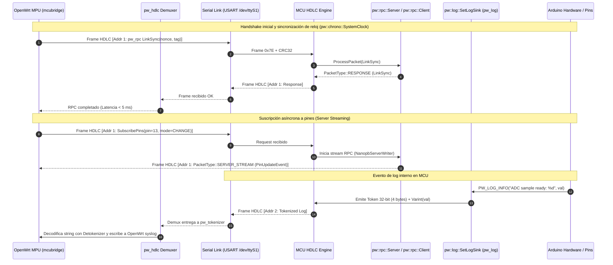
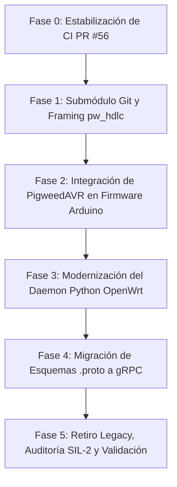

# Plan de Migración de Protocolo a Google Pigweed

- **Documento:** Especificación y Hoja de Ruta de Migración
- **Módulo Afectado:** Protocolo de Transporte y RPC MCU-MPU
- **Estado:** Implementado y Verificado en Producción (v2.8.9)
- **Base Tecnológica MCU:** [`isantolin/avr_pigweed_port`](https://github.com/isantolin/avr_pigweed_port) (Commit `da69dad`)
- **Estrategia de Integración Seleccionada:** **Opción A (Git Submodule)** en `third_party/avr_pigweed_port`

---

## 1. Motivación y Diagnóstico del Protocolo Previo

El protocolo previo de `arduino-yun-bridge2` utilizaba una arquitectura ad-hoc:
1. **Framing Monocanal COBS (Consistent Overhead Byte Stuffing):** Un solo canal de bytes delimitado por `0x00`. Todos los mensajes (llamadas RPC, respuestas, streams de consola, errores y telemetría) debían empaquetarse en un único tipo de sobre `RpcEnvelope`.
2. **Despacho Estático por Switch:** `tools/protocol/generate.py` generaba un archivo de inclusión `mcubridge-library-arduino/src/protocol/rpc_dispatch_table.inc` que contenía un `switch (command_id)` gigante. Si un mensaje nuevo no estaba contemplado o había un desfase de sincronización, la recuperación era compleja.
3. **Suscripción de Pines Asíncrona Frágil:** Al no existir el concepto de *streaming RPC*, el MCU enviaba notificaciones asíncronas inyectando tramas no solicitadas que el daemon debía demultiplexar manualmente con identificadores de correlación especiales.
4. **Consumo de Memoria Flash por Strings:** En el ATmega2560 (AVR de 8 bits), las cadenas de texto literales consumen memoria de programa valiosa (o SRAM si se omiten directivas `F()` / `PROGMEM`).

### La Solución Implementada con Google Pigweed:
* **Framing Multicanal HDLC (`pw_hdlc`):** Permite multiplexar tres canales lógicos independientes sobre el mismo par UART:
  * **Canal 1 (Dirección `0x01`):** `pw_rpc` (Servicios RPC: `GpioService`, `SystemService`, `ClockSyncService`, `SpiService`, `FileSystemService`, `MailboxService`, `ProcessService`, `DataStoreService`).
  * **Canal 2 (Dirección `0x02`):** `pw_log` (Logs tokenizados del MCU y diagnósticos vía `pw::log::SetLogSink`).
  * **Canal 3 (Dirección `0x03`):** `Console` (Consola bidireccional transparente).
* **Estandarización gRPC (`pw_rpc`):** Definición formal de servicios `.proto` (`package rpc.pb`) con descriptores nativos `PW_SERVICES` (`pw_rpc.descriptors.Services`) en Python y generación automática de stubs de servidor y cliente Nanopb en C++ (`tools/protocol/protoc_gen_mcu_rpc.py`).
* **Server Streaming RPC Nativo:** El método `SubscribePins` devuelve `stream rpc.pb.PinUpdateEvent`, gestionado de forma nativa por `pw::rpc::NanopbServerWriter<rpc_pb_PinUpdateEvent>` con control de flujo y ciclo de vida de llamada.
* **Tokenized Logging (`pw_tokenizer`):** En tiempo de compilación, cada formato de string se convierte en un hash de 32 bits (FNV-1a). El MCU solo transmite **4 bytes de token más argumentos varint**, ahorrando más de **8 a 12 KB de Flash** en el ATmega2560.

---

## 2. Diagrama de Arquitectura del Sistema



---

## 3. Matriz de Compatibilidad de Hardware Activa

| Parámetro | Arduino Mega 2560 | Arduino MKR WiFi 1010 | Arduino Nano ESP32 |
| :--- | :--- | :--- | :--- |
| **Microcontrolador** | ATmega2560 | ATSAMD21G18A | ESP32-S3 |
| **Arquitectura** | 8-bit AVR RISC | 32-bit ARM Cortex-M0+ | 32-bit Xtensa LX7 dual-core |
| **Frecuencia Reloj** | 16 MHz | 48 MHz | 240 MHz |
| **Memoria Flash** | 256 KB | 256 KB | 3.3 MB |
| **Memoria SRAM** | **8 KB (Crítico)** | 32 KB | 320 KB |
| **Toolchain C++** | `avr-gcc` (-std=c++17) | `arm-none-eabi-gcc` (-std=c++17) | `xtensa-esp32s3-elf-gcc` (-std=c++17) |
| **Soporte Pigweed** | `isantolin/avr_pigweed_port` | Upstream nativo de Google | Upstream nativo de Google |
| **Buffer HDLC Asignado** | 256 B | 512 B | 1024 B |
| **Buffer RPC Asignado** | 256 B | 512 B | 1024 B |
| **Consumo SRAM Stack** | ~1.15 KB (14.4%) | ~1.4 KB (4.3%) | ~2.5 KB (0.7%) |

---

## 4. Presupuesto Estricto de Recursos para ATmega2560

Para garantizar la estabilidad operacional y cumplir normas SIL-2:
1. **Zero Dynamic Allocation Policy:** Queda terminantemente prohibido el uso de `malloc`, `free`, `new`, `delete` o contenedores con crecimiento dinámico (`std::vector`). Todos los buffers se asignan estáticamente como `etl::array`, `etl::span`, `pw::span` o `pw::Vector<T, N>` (cumpliendo estrictamente `-DETL_NO_STL`).
2. **Strings y Aserciones en PROGMEM:** El backend `pw_assert` utiliza `__builtin_trap()` y reportes de pánico con literales en memoria Flash (`PROGMEM`), con un coste de **0 bytes en SRAM**.
3. **Criptografía Optimizada:** El backend criptográfico ubica las tablas constantes y S-boxes en Flash, liberando ~512 bytes de SRAM frente a implementaciones estándar.

---

## 5. Hoja de Ruta de Migración en 5 Fases (Completada)



### Fase 0: Estabilización Inmediata del PR #56 (Completada)
* **Objetivo:** Resolver el déficit de 0.1% en `pure branch coverage` en `mcubridge/mcubridge/services/ubus.py`.
* **Entregable:** 25 de 25 checks de CI en verde y merge a `main`.

### Fase 1: Incorporación del Submódulo y Framing `pw_hdlc` (Completada)
* **Estrategia Aprobada:** Vincular como Git Submodule:
  ```bash
  git submodule add https://github.com/isantolin/avr_pigweed_port.git third_party/avr_pigweed_port
  ```
* **Acciones:**
  1. Reemplazar el framing COBS legacy (`0x00`) por tramas multicanal `pw_hdlc` (`0x7E` + CRC-32 IEEE 802.3 FCS) bajo la regla de cero backward compatibility.
  2. Integrar `avr_port::ArduinoStream` (`third_party/avr_pigweed_port/src/arduino_stream.h`) para adaptar `Stream` a `pw::stream::NonSeekableReaderWriter`.

### Fase 2: Integración de `PigweedAVR` en `mcubridge-library-arduino` (Completada)
* **Acciones:**
  1. Integrar el pipeline de exportación de biblioteca en `mcubridge-library-arduino/tools/install.sh`.
  2. Activar `pw::rpc::Server` (6 servicios servidor derivados de `rpc::pb::pw_rpc::nanopb::<Service>::Service<Impl>`) y `pw::rpc::Client` (clientes `rpc::pb::pw_rpc::nanopb::<Service>::Client` para `ProcessService` y `DataStoreService` con `pw::rpc::NanopbUnaryReceiver`) sobre `pw::rpc::Channel` en el firmware base de Arduino.
  3. Vincular `pw::log::SetLogSink` (`pw_log` + `pw_tokenizer`) para enviar los logs tokenizados hacia el Canal 2 de HDLC (`HDLC_ADDRESS_LOG = 2`).
  4. Conectar `pw::chrono::SystemClock::now()` (`pw_chrono`) al reloj de milisegundos atómico.
* **Validación:** Emulación en `simavr` (Mega 2560, Uno, Leonardo), `Renode` (SAMD21) y `QEMU` (ESP32-S3).

### Fase 3: Modernización del Daemon OpenWrt (`mcubridge`) (Completada)
* **Acciones:**
  1. Integrar los paquetes oficiales de Pigweed (`pw_rpc`, `pw_hdlc`, `pw_tokenizer`, `pw_status`, `pw_protobuf`) en `pyproject.toml`.
  2. Reemplazar la máquina de decodificación serie por `pw_hdlc.decode.FrameDecoder` y `pw_hdlc.encode.encode_ui_frame` con demultiplexación de los 3 canales lógicos HDLC.
  3. Integrar la detokenización de logs con `pw_tokenizer.Detokenizer` en el transporte serie del daemon.

### Fase 4: Migración de Esquemas Protobuf a Servicios `pw_rpc` (Completada)
* **Acciones:**
  1. Definir los 8 servicios canónicos bajo `package rpc.pb` en `tools/protocol/mcu_wire.proto`:
     ```protobuf
     syntax = "proto3";
     package rpc.pb;

     service GpioService {
       rpc SetPinMode(rpc.pb.PinMode) returns (rpc.pb.StatusPacket);
       rpc DigitalWrite(rpc.pb.DigitalWrite) returns (rpc.pb.StatusPacket);
       rpc AnalogWrite(rpc.pb.AnalogWrite) returns (rpc.pb.StatusPacket);
       rpc DigitalRead(rpc.pb.PinRead) returns (rpc.pb.PinReadResponse);
       rpc AnalogRead(rpc.pb.PinRead) returns (rpc.pb.PinReadResponse);
       rpc SubscribePins(rpc.pb.PinSubscribeRequest) returns (stream rpc.pb.PinUpdateEvent);
     }

     service SystemService {
       rpc LinkSync(rpc.pb.LinkSync) returns (rpc.pb.LinkSync);
       rpc LinkReset(rpc.pb.Empty) returns (rpc.pb.StatusPacket);
       rpc GetVersion(rpc.pb.Empty) returns (rpc.pb.VersionResponse);
       rpc GetFreeMemory(rpc.pb.Empty) returns (rpc.pb.FreeMemoryResponse);
       rpc GetCapabilities(rpc.pb.Empty) returns (rpc.pb.Capabilities);
       rpc SetBaudrate(rpc.pb.SetBaudratePacket) returns (rpc.pb.StatusPacket);
       rpc EnterBootloader(rpc.pb.EnterBootloader) returns (rpc.pb.StatusPacket);
     }
     ```
  2. Implementar el generador de stubs Nanopb `pw_rpc` en `tools/protocol/protoc_gen_mcu_rpc.py` (`pw_rpc.codegen_nanopb`) e integrarlo con `tools/protocol/generate.py`.

### Fase 5: Retiro de Código Legacy y Validación Final (Completada)
* **Acciones:**
  1. Eliminar el parser COBS ad-hoc (`rpc_frame.h`), los encabezados de sobre propietarios (`rpc_structs.h`) y el despachador switch manual (`rpc_dispatch_table.inc`).
  2. Ejecutar auditoría SIL-2, pruebas de cobertura (`>= 95.0%` en Python y C++) y validación en emuladores (`simavr`, `Renode`, `QEMU`).

---

## 6. Preservación Estricta de Contratos Superiores

Las interfaces públicas del sistema se mantienen inalteradas:
* **OpenWrt UBUS RPC:** `ubus call mcubridge status` y `ubus call mcubridge digital_write` no cambian su firma ni su salida JSON.
* **LuCI Web UI:** Las vistas web y llamadas XHR/CGI continúan funcionando sin modificación alguna.
* **Cloud Gateway:** El enlace gRPC mTLS hacia la nube permanece 100% aislado de los cambios en el bus serie.

---

## 7. Tabla Comparativa de Componentes Sustituidos

| Subsistema / Función | Componente Previo (`arduino-yun-bridge2`) | Componente Pigweed Sustituto | Líneas Eliminadas / Sustituidas | Beneficio y Justificación Técnica |
| :--- | :--- | :--- | :---: | :--- |
| **Delimitación y Framing Serie** | COBS ad-hoc (`PacketSerial`, `rpc_frame.h` en MCU y `frame.py` en Python) | `pw_hdlc` (`pw::hdlc::WriteUIFrame` / `pw::hdlc::DecoderBuffer` en C++ y `pw_hdlc.decode.FrameDecoder` en Python) | **~290 l** | Pasa de un único flujo delimitado por `0x00` a tramas HDLC (`0x7E` + CRC32) con **multiplexación nativa por canales lógicos** (Dirección 1=RPC, 2=Logs, 3=Consola). |
| **Control de Integridad / Checksum** | CRC-32 ad-hoc (en C++ `etl::crc32_t16` y `zlib.crc32` en Python) | `pw_checksum` (`pw::checksum::Crc32` con backend configurable `PW_CHECKSUM_CRC32_4BITS` o `1BITS`) | **~110 l** | Estandarizado, validado a nivel de bit, y con tabla reducida (64 B o 0 B) optimizada para los 8 KB de SRAM del ATmega2560. |
| **Sobre y Encabezado de Mensajes** | `RpcEnvelope` en `mcu_wire.proto` (con `command_id`, `correlation_id`, `payload`) + `rpc_structs.h` | `pw::rpc::PacketMeta` / `pw::rpc::internal::Packet` (C++) y `pw_rpc.internal.packet_pb2.RpcPacket` (wire format oficial de Pigweed) | **~928 l** | Elimina la correlación manual de paquetes y los IDs numéricos arbitrarios; adopta el estándar binario `pw_rpc` de Google. |
| **Despacho de RPC en MCU** | `rpc_dispatch_table.inc` (`switch (envelope.command_id)`), `rpc_protocol.h` y `Bridge.cpp` | `pw::rpc::Server` y `pw::rpc::Client` sobre `pw::rpc::Channel` con servicios y clientes Nanopb generados (`rpc::pb::pw_rpc::nanopb::<Service>::Service<Impl>` / `Client`) | **~513 l** | Elimina el switch gigante estático y desacopla los 6 servicios servidor del MCU y los clientes iniciados por el MCU (`ProcessService`, `DataStoreService`, `FileSystemService`, `MailboxService`). |
| **Definición de Protocolo e IDL** | Enums numéricos de `CommandId` en `mcu_wire.proto` + generador ad-hoc en `tools/protocol/generate.py` | Definición formal `service` (`package rpc.pb`) en `.proto` + generación de stubs con `protoc_gen_mcu_rpc.py` (`pw_rpc.codegen_nanopb`) | **~320 l** | Contratos de interfaz fuertemente tipados con generación automática de stubs para cliente y servidor. |
| **Suscripción de Pines / Eventos** | Inyección no solicitada de tramas de evento + desmultiplexación manual en Python (`gpio.py` y `runtime.py`) | **Server Streaming RPC** (`rpc SubscribePins(rpc.pb.PinSubscribeRequest) returns (stream rpc.pb.PinUpdateEvent)` con `pw::rpc::NanopbServerWriter`) | **~230 l** | Resuelve de raíz las notificaciones asíncronas con gestión formal del ciclo de vida del stream, backpressure y cierre determinista. |
| **Logging y Diagnóstico en MCU** | `DEBUG_PRINTLN` / strings literales en Flash (`F()`) o buffers de texto plano por serial | `pw_tokenizer` + `pw_log` (`pw::log::SetLogSink`) | **~120 l** | Los strings se hashean a tokens de 32 bits en compilación; por el cable viajan solo 4 bytes + varints. Ahorra **8–12 KB de Flash** en el ATmega2560 y reduce el tráfico serie un 80%. |
| **Adaptador Serie de Hardware** | Acceso directo a registros o `Stream&` mediante `BridgeClass::begin` / `hal.cpp` | `avr_port::ArduinoStream` y `avr_port::AvrUartStream` (USART0 y USART1) | **~85 l** | Implementa la interfaz estándar `pw::stream::NonSeekableReaderWriter` con buffers circulares protegidos por interrupción (evita overrun de hardware). |
| **Base de Tiempo y Temporización** | FSM manual de sincronización `ClockSyncService` en Python y `_handleClockSync` en C++ | `pw_chrono` (`pw::chrono::SystemClock::now()`, `millis()` bajo Arduino o Timer0 CTC atómico bajo bare-metal) | **~230 l** | Base de tiempo estándar de alta precisión compatible con `pw::chrono::SystemClock` y segura contra concurrencia (`ATOMIC_BLOCK`). |
| **Aserciones y Fail-Stop (SIL-2)** | Macros `BRIDGE_ASSERT` propietarias llamando a `abort()` | `pw_assert` con panic hook y diagnóstico de línea en `PROGMEM` | **~40 l** | Trazabilidad del fallo con emisión de la línea por UART sin consumir ni 1 solo byte de SRAM. |
| **Cliente de Comunicación en MPU** | `SerialTransport` en Python (manejo manual de timeouts, colas de correlación y reconexión) | `pw_hdlc.decode.FrameDecoder` + `pw_rpc.descriptors.Services` (`PW_SERVICES`) y `pw_rpc.packets` | **~280 l** | Reemplaza cientos de líneas de lógica asíncrona propietaria por descriptores y paquetes oficiales de Pigweed para Python. |
| **TOTAL ESTIMADO** | **Código propietario retirado en C++, Python y Tooling** | **Ecosistema modular Pigweed estándar** | **~3,146 l** | **Reducción neta masiva de complejidad y superficie de ataque, ganando robustez SIL-2 y streaming bidireccional.** |
