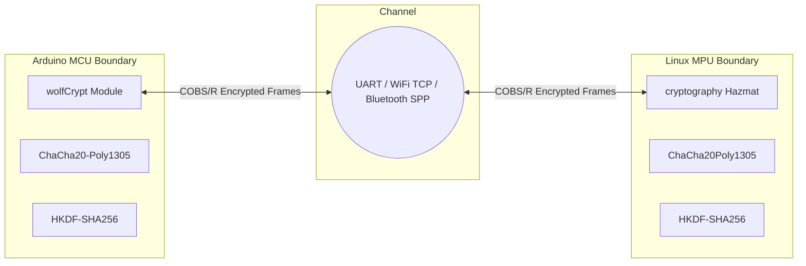

# Cryptographic Implementation Profile (Not a FIPS 140-3 Security Policy)

**Status:** This document describes project implementation details only. It is not a CMVP-issued FIPS 140-3 Security Policy, and this repository does not claim FIPS 140-3 validation or provide a validation certificate number. KATs, library use, and standards references are not evidence of module validation.
**References:** RFC 8439, RFC 5869, NIST SP 800-56C Rev 2
**Implementation:** Arduino MCU Bridge 2 cryptographic code
**Software Version:** v2.8.5+  

---

## 1. Implementation Scope (Not a Validated Cryptographic Boundary)

The implementation includes a mutual handshake, session-key derivation, and authenticated encryption connecting the Arduino MCU (C++ / wolfCrypt) and Linux MPU (Python / `cryptography`). This description is not an assessed or validated cryptographic-module boundary.

---

## 2. Roles, Services, and Authentication

### 2.1 Supported Roles
1. **User Role**: Standard operational role capable of issuing RPC calls (I/O, Mailbox, DataStore, Console, FileSystem, SPI) over the authenticated channel.
2. **Crypto Officer Role**: Responsible for configuring pre-shared keys (`serial_shared_secret` via UCI) and triggering credential rotation (`mcubridge-rotate-credentials`).

### 2.2 Critical Security Parameters (CSPs)
* **Master Pre-Shared Key ($K_{master}$)**: 256-bit secret stored in UCI `/etc/config/mcubridge` (MPU) and compiled/provisioned in Arduino sketch (MCU).
* **Ephemeral Session Key ($K_{session}$)**: 256-bit symmetric key derived dynamically per session using HKDF-SHA256.
* **Monotonic Nonce Counter ($N_{seq}$)**: 64-bit strictly increasing anti-replay counter.

---

## 3. Implemented Algorithms & Project Self-Tests

### 3.1 Algorithms and References

| Algorithm | Standard | Key Size | Purpose |
| :--- | :--- | :--- | :--- |
| **ChaCha20-Poly1305** | RFC 8439 | 256-bit | Authenticated Encryption with Associated Data (AEAD) |
| **HKDF-SHA256** | RFC 5869; NIST SP 800-56C Rev 2 reference | 256-bit | Key Derivation Function (KDF) |
| **HMAC-SHA256** | FIPS 198-1 / FIPS 180-4 references | 256-bit | Handshake Mutual Verification Tag |
| **SHA-256** | FIPS 180-4 reference | 256-bit | Cryptographic Hashing |

### 3.2 Startup Known-Answer Tests (KATs)
The endpoints run project-owned known-answer tests before normal operation:
1. **SHA-256 KAT**: Checks the digest for the configured test input.
2. **HMAC-SHA256 KAT**: Checks the implementation's configured HMAC test vector.
3. **ChaCha20-Poly1305 KAT**: Checks ciphertext and tag for the implementation's configured key, nonce, AAD, and plaintext.
4. **Failure behavior**: A failed check prevents normal cryptographic operation.

These functional regression checks are not CAVP testing or FIPS 140-3 module validation.

---

## 4. Key Management & Zeroization

### 4.1 Ephemeral Key Derivation
Session keys are derived using HKDF-SHA256 with the shared secret as input key material, the handshake nonce as salt, the canonical `session-key` info string, and the configured 32-byte output length.

### 4.2 Anti-Replay Nonce Layout
Every encrypted frame carries a 12-byte nonce: a four-byte direction prefix (`MCU\0` for MCU-originated frames or `MPU\0` for MPU-originated frames), followed by an eight-byte big-endian counter.
The canonical prefixes are generated from `mcubridge.proto`. Current receivers validate the nonce length and monotonic counter suffix; they do not reject frames based on the prefix, preserving interoperability with existing peers. Replay checks compare the counter to the last accepted counter.

### 4.3 Key Zeroization (*Safe Memory Scrubbing*)
* **C++ MCU**: Memory containing $K_{session}$ and intermediate buffers is zeroized using `wc_ForceZero()` to defeat compiler dead-store elimination.
* **Python MPU**: `secure_zero()` overwrites the supplied mutable `bytearray` or writable `memoryview`. It cannot guarantee removal of immutable copies or every copy retained by the interpreter, allocator, or native libraries; it is not a process-wide zeroization guarantee.

### 4.4 TLS 1.3 0-RTT Session Ticket Management (Cloud Gateway)
* **Storage**: Ephemeral session tickets for fast gRPC 0-RTT re-handshakes are cached in LMDB (`RuntimeState.tls_session_cache`) with process-level access permissions.
* **Lifecycle & Anti-Replay**: Session tickets have strict time-to-live bounds and single-use resumption policies, preventing TLS 1.3 early-data replay attacks.
