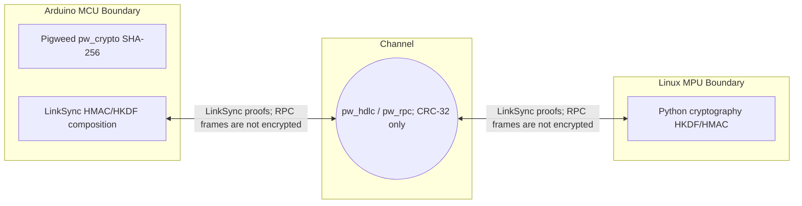

# Cryptographic Implementation Profile (Not a FIPS 140-3 Security Policy)

**Status:** This document describes project implementation details only. It is not a CMVP-issued FIPS 140-3 Security Policy, and this repository does not claim FIPS 140-3 validation or provide a validation certificate number. KATs, library use, and standards references are not evidence of module validation.
**References:** RFC 8439, RFC 5869, NIST SP 800-56C Rev 2
**Implementation:** Arduino MCU Bridge 2 cryptographic code
---

## 1. Implementation Scope (Not a Validated Cryptographic Boundary)

The current link protocol authenticates `LinkSync` when a shared secret is configured. It does not derive a session encryption key, encrypt RPC frames, or provide per-frame replay protection. This description is not an assessed or validated cryptographic-module boundary.

---

## 2. Roles, Services, and Authentication

### 2.1 Supported Roles
1. **User Role**: Standard operational role capable of issuing RPC calls (I/O, Mailbox, DataStore, Console, FileSystem, SPI) over the authenticated channel.
2. **Crypto Officer Role**: Responsible for configuring pre-shared keys (`serial_shared_secret` via UCI) and triggering credential rotation (`mcubridge-rotate-credentials`).

### 2.2 Critical Security Parameters (CSPs)
* **Master Pre-Shared Key ($K_{master}$)**: 256-bit secret stored in UCI `/etc/config/mcubridge` (MPU) and compiled/provisioned in Arduino sketch (MCU).

---

## 3. Implemented Algorithms & Project Self-Tests

### 3.1 Algorithms and References

| Algorithm | Standard | Key Size | Purpose |
| :--- | :--- | :--- | :--- |
| **HKDF-SHA256** | RFC 5869; NIST SP 800-56C Rev 2 reference | 256-bit | Key Derivation Function (KDF) |
| **HMAC-SHA256** | RFC 2104 / FIPS references | 256-bit | Domain-separated `LinkSync` request and response proofs |
| **SHA-256** | FIPS 180-4 reference | 256-bit | Cryptographic Hashing |

### 3.2 Startup Known-Answer Tests (KATs)
The MCU POST runs project KATs for SHA-256 and HMAC-SHA256. The Python daemon's integrity check also tests a ChaCha20-Poly1305 vector through `cryptography`; that check does not imply link-frame encryption.

These functional regression checks are not CAVP testing or FIPS 140-3 module validation.

---

## 4. Key Management & Zeroization

### 4.1 Ephemeral Key Derivation
The host request and MCU response proofs use HKDF-SHA256 with the configured shared secret, the canonical `mcubridge-v2` salt, separate `handshake-auth` and `handshake-response` info strings, and HMAC-SHA256 over the 16-byte host nonce. No session encryption key is derived.

### 4.2 Nonce and Replay
The daemon creates a 16-byte random nonce for each `LinkSync`; the MCU checks its exact length and binds both HMAC proofs to it. There is no per-frame nonce, monotonic frame counter, or replay state. The handshake nonce does not prevent replay of previously captured RPC frames.

### 4.3 Key Zeroization
* **C++ MCU**: Explicit `secure_zero()` calls clear the local HMAC/HKDF key pads, derived key arrays, tags, and expected-tag buffers. This is not a guarantee that every library-internal copy is erased.
* **Python MPU**: `secure_zero()` overwrites the supplied mutable `bytearray` or writable `memoryview`. It cannot guarantee removal of immutable copies or every copy retained by the interpreter, allocator, or native libraries; it is not a process-wide zeroization guarantee.

### 4.4 Cloud Transport
The cloud gateway's TLS behavior is configured separately through its gRPC/TLS stack. This profile makes no project-specific 0-RTT, single-use-ticket, or anti-replay claim.
