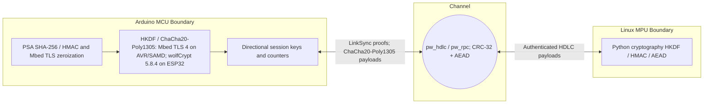

# Cryptographic Implementation Profile (Not a FIPS 140-3 Security Policy)

**Status:** This document describes project implementation details only. It is not a CMVP-issued FIPS 140-3 Security Policy, and this repository does not claim FIPS 140-3 validation or provide a validation certificate number. KATs, library use, and standards references are not evidence of module validation.
**References:** RFC 8439, RFC 5869, NIST SP 800-56C Rev 2
**Implementation:** Arduino MCU Bridge 2 cryptographic code
---

## 1. Implementation Scope (Not a Validated Cryptographic Boundary)

When a shared secret is configured, the link authenticates `LinkSync`, derives directional session keys, and protects RPC, console, and log HDLC payloads with ChaCha20-Poly1305. This description is not an assessed or validated cryptographic-module boundary. Counter-based replay rejection is limited to one session; replay across MCU restarts is not ruled out.

---

## 2. Roles, Services, and Authentication

### 2.1 Supported Roles
1. **User Role**: Standard operational role capable of issuing RPC calls (I/O, Mailbox, DataStore, Console, FileSystem, SPI) over the authenticated channel.
2. **Crypto Officer Role**: Responsible for configuring pre-shared keys (`serial_shared_secret` via UCI) and triggering credential rotation (`mcubridge-rotate-credentials`).

### 2.2 Critical Security Parameters (CSPs)
* **Master Pre-Shared Key ($K_{master}$)**: 256-bit secret stored in UCI `/etc/config/mcubridge` (MPU) and compiled/provisioned in Arduino sketch (MCU).

---

## 3. Implemented Algorithms & Project Self-Tests

### 3.1 Algorithms and References

| Algorithm | Standard | Key Size | Purpose |
| :--- | :--- | :--- | :--- |
| **HKDF-SHA256** | RFC 5869; NIST SP 800-56C Rev 2 reference | 256-bit | Key Derivation Function (KDF) |
| **HMAC-SHA256** | RFC 2104 / FIPS references | 256-bit | Domain-separated `LinkSync` request and response proofs |
| **SHA-256** | FIPS 180-4 reference | 256-bit | Cryptographic Hashing |
| **ChaCha20-Poly1305** | RFC 8439 | 256-bit key, 96-bit nonce | Authenticated encryption of protected HDLC payloads |

### 3.2 Startup Known-Answer Tests (KATs)
The MCU POST runs project KATs for SHA-256, HMAC-SHA256, and ChaCha20-Poly1305. The Python daemon's integrity check tests a ChaCha20-Poly1305 vector, and transport tests exercise protected frames.

These functional regression checks are not CAVP testing or FIPS 140-3 module validation.

---

## 4. Key Management & Zeroization

### 4.1 Ephemeral Key Derivation
The host request and MCU response proofs use HKDF-SHA256 with the configured shared secret, the canonical `mcubridge-v2` salt, separate `handshake-auth` and `handshake-response` info strings, and HMAC-SHA256 over the 16-byte host nonce. A separate HKDF-SHA256 derivation uses the host nonce as salt and `session-key` as info to produce independent 256-bit keys for each direction.

### 4.2 Nonce and Replay
The daemon creates a 16-byte random nonce for each `LinkSync`; the MCU checks its exact length and binds both HMAC proofs to it. Each protected frame carries an 8-byte big-endian counter used as the final eight bytes of its 96-bit nonce; the first four bytes are zero. The receiver rejects counters that are zero or not strictly greater than the last accepted counter for that direction.

The MCU does not currently have a demonstrated persistent boot epoch or cross-platform cryptographic random source. Consequently, replay of an old authenticated `LinkSync` exchange and its captured frames after an MCU restart is not ruled out. `LinkReset` remains an explicit plaintext recovery control, not a plaintext fallback for data.

### 4.3 Key Zeroization
* **C++ MCU**: Mbed TLS platform zeroization clears derived keys, output buffers, handshake intermediates, and the stored shared secret when the bridge is reinitialized. This is not a guarantee that every library-internal copy is erased.
* **Python MPU**: `secure_zero()` overwrites the supplied mutable `bytearray` or writable `memoryview`. It cannot guarantee removal of immutable copies or every copy retained by the interpreter, allocator, or native libraries; it is not a process-wide zeroization guarantee.

### 4.4 Cloud Transport
The cloud gateway's TLS behavior is configured separately through its gRPC/TLS stack. This profile makes no project-specific 0-RTT, single-use-ticket, or anti-replay claim.
